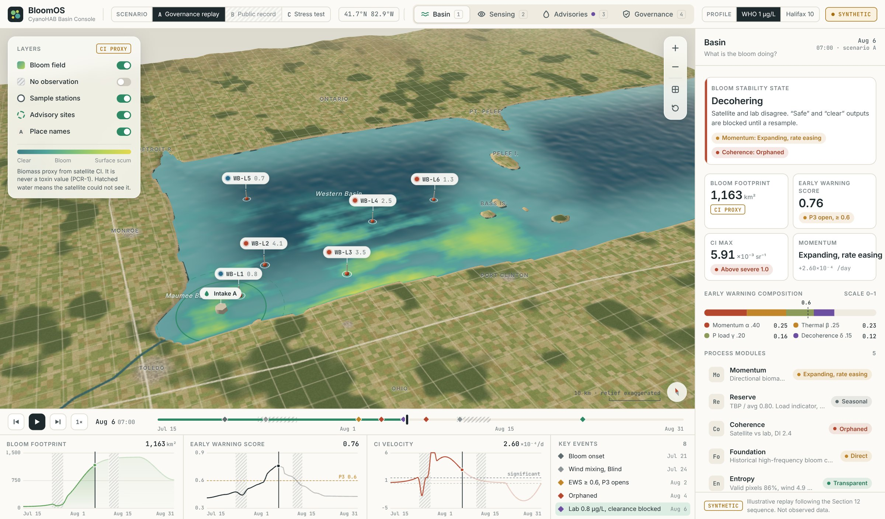

# BloomOS / CyanoHAB Protocol

**Sovereign Process Architecture deployment specification for cyanobacterial harmful algal bloom detection and cyanotoxin risk governance.**

A complete architectural specification encoding established NOAA/NCCOS cyanobacteria detection methodology — the Cyanobacteria Index (CI), 10-day maximum-value composite windows, and the V0–V4 quality flag sequence documented in NOAA Technical Memorandum NOS NCCOS 252 — into deterministic, auditable governance software with an immutable SHA-256 hash-chain Flight Recorder audit trail. The architecture treats the CI not as a visualization product but as a process control signal.

*BloomOS Basin Console, an interface demonstrator for this specification. Every value shown is synthetic; it is not observed data and is not affiliated with or endorsed by NOAA. [More screenshots](docs/screenshots/README.md) · [Public-record data for 2014 and 2019](data/public-record/README.md)*

---

## Publication Context

This document is the architectural specification authored by **Sovereign Process Architecture Inc.** (Corporation Number 1781822-0, federally incorporated April 2026), built on publicly available research from NOAA/NCCOS, the U.S. EPA, the World Health Organization, the Halifax Regional Municipality, and the broader peer-reviewed scientific literature. All methodology lineage is fully cited throughout the document (see References and Appendix D — Validation Matrix). All underlying research cited is in the public domain or otherwise publicly available without use restrictions.

The four architectural invariants, V0–V7 Validator Node Pipeline, eight Prohibited Content Rules, Socratic Handshake gates H1–H4, Agency Score with recency decay, and Flight Recorder design are the original intellectual property of Sovereign Process Architecture Inc.

This specification is published to establish architectural priority and to make the methodology publicly available to water utilities, municipal authorities, regulatory bodies, and academic groups working in the same problem space.

## License

This methodology specification is licensed under **Creative Commons Attribution-NonCommercial-ShareAlike 4.0 International** (CC BY-NC-SA 4.0). The document may be read, adapted, and cited freely with attribution to *Sovereign Process Architecture Inc.* Commercial use of the architectural framework — any system that materially encodes the four SPA invariants, the V0–V7 Validator Node Pipeline, the Prohibited Content Rules, the Socratic Handshake Gates, or the Flight Recorder design — requires separate written permission from SPA Inc.

The ten calibration parameters labeled *[engineering estimate]* or *[pending calibration]* throughout this specification require empirical validation before operational deployment. The architectural guarantees of Section 11.1 hold by design regardless of the values of any numerical parameter.

## Author

**Regis Benoit Brice Nde Tene** — Lead Architect, Sovereign Process Architecture Inc.

Inquiries: regisndetene@gmail.com  ·  [SPA Inc. profile](https://github.com/chopinregis/Chopinregis)

---

**BLOOMOS**

**CyanoHAB Protocol / Sovereign Process Architecture**

Master Architectural Specification — NOAA/NCCOS Methodology Lineage

**v1.0 REV3**

**Author: Regis Benoit Brice Nde Tene**

Lead Architect Designation: Sovereign Process Architecture

Date: March 2026  •  Document Class: Scientific Operating System Architecture

***REV3 Scope:** This revision incorporates final technical refinements following internal review. Additions include: physical justification for Agency Score decay (bloom-cycle alignment); H3 handshake automatic fail logic; explicit sensor uncertainty bounds (±36% for 10-day composites); PCR-8 governing predictive escalations; corrected unit semantics (Appendix F); and the Section 12 Toledo 2014 counterfactual pre-mortem. No implementation is authorized without completed calibration of Section 11 parameters.*

# Document Control

## **Revision History**

| **Version** | **Date** | **Author** | **Summary** | **Status** |
| - | - | - | - | - |
| v0.1 | 2026-01-15 | RBBNT | Domain intake and structural failure analysis (Internal). | Superseded |
| v0.9 | 2026-01-29 | RBBNT | Draft for Internal Technical Review; five-module mapping. | Superseded |
| v1.0 REV1 | 2026-02-12 | RBBNT | **Initial Master Specification**; baseline logic and gates. | Superseded |
| v1.0 REV2 | 2026-02-24 | RBBNT | Integration of Halifax protocols and CyanNet fallback logic. | Superseded |
| v1.0 REV3 | 2026-03-06 | RBBNT | **Current Master Specification**: Final peer-review refinements; Appendix E/F added. | **Current** |

# Table of Contents

Executive Summary

Section 1: Problem Definition

1.1 The Core Distress

1.2 Redefining the Product

1.3 Scope

Section 2: Architectural Invariants

2.1 SPA as Trust Backbone

2.2 Existing Governance as Executable Logic

2.3 Logic Hierarchy

2.4 Context Creates Meaning

Section 3: System Overview

3.1 Layered Architecture

3.2 Minimal Viable Sensor Envelope

3.3 Data Products

Section 4: Event Model

Section 5: Process Modules

Section 6: Process Physics

Section 7: Sovereign Governance Layer

7.1 Flight Recorder

7.2 Defense-in-Depth Pipeline (V0–V7)

7.3 Socratic Handshake Gates H1–H4 + Agency Score

7.4 Prohibited Content Rules

7.5 Certification Tier Structure

Section 8: Operating Protocol / Runbook

Section 9: Governance Gates as Executable Logic

Section 10: Implementation Architecture

Section 11: Validation Plan — Epistemic Boundary

Section 12: Counterfactual Pre-Mortem — Toledo 2014

Appendix A: Event Model and Canonical Schemas

Appendix B: Canonical Mathematics

Appendix C: Validator Node JSON Contracts

Appendix D: Validation Matrix

Appendix E: Calibration Dataset Specification

Appendix F: Canonical Units and Variable Semantics

References

# Executive Summary

The Lake Erie harmful algal bloom detection system currently operates with a 3–7 day latency between sample collection and actionable toxin results. During that window, a cyanobacteria bloom can double in biomass, shift five kilometres due to wind, or completely dissipate. Public health decisions—beach closures, drinking water advisories, shellfish bed restrictions—are made based on data describing where the bloom was, not where it is. The 2014 Toledo water crisis, which left 500,000 people without drinking water for three days, was a direct consequence of this governance latency: the bloom trajectory was visible from satellite days before the toxin results arrived, but the system had no mechanism to act on that trajectory.

BloomOS treats the Cyanobacteria Index (CI) not as a visualization product but as a process control signal. The architecture enforces four invariants—Provenance-First Verification, Gate-Ordered Reasoning Hierarchy, Longitudinal Window-Based Truth, and Deterministic Validator with Prohibited Content—and encodes the NOAA Technical Memorandum NOS NCCOS 252 processing guidelines as executable validator gates rather than reference text. The canonical unit of truth is the 10-day maximum-value composite, consistent with 15 years of Lake Erie operational practice established by Wynne and Stumpf.

Context Creates Meaning — **语境生义** (Yǔjìng shēng yì). In BloomOS, a CI value of 0.001 has no meaning without its 10-day composite history, its quality flag trajectory, its position within historical frequency corridors, and its relationship to the preceding seven days of wind mixing. Context is not metadata; context is the only valid unit of analysis.

Key outcomes delivered by this deployment are listed below.

| **Outcome** | **Mechanism** | **Source Anchor** |
| - | - | - |
| Latency quantification | Every decision carries a timestamp showing the gap between last satellite observation, last lab result, and current system time. | SPA Invariant III |
| Decoherence detection | Automated flagging when satellite biomass trajectory and lab toxin results diverge beyond historical norms, forcing resampling. | Seegers et al. 2021; SPA Invariant II |
| Momentum-based warnings | Advisories can be triggered by sustained biomass acceleration even before toxin confirmation. | Stumpf et al. 2012 |
| Provenance-first audit | Every output includes complete processing history: sensor IDs, flag status, composite window, calibration coefficients. | Wynne et al. 2018; SPA Invariant I |
| Prohibited content enforcement | Architecture blocks toxin quantification from satellite alone, species ID without qPCR, and ‘safe’ declarations from single grab samples. | Reynolds et al. 2023 |
| Epistemic boundary clarity | Section 11 explicitly lists which parameters require joint calibration with NOAA; the architecture makes no claims beyond its engineering guarantees. | SPA Section 11 mandate |
| Calibration dataset specification | Appendix E names every uncalibrated coefficient, the responsible domain authority, sample size requirements, and statistical method. | New — REV2 Gap resolution |
| Toledo 2014 counterfactual | Section 12 walks through the 2014 Toledo water crisis step-by-step showing how BloomOS architecture would have changed the timeline. | REV3 addition |

*All thresholds and weights labeled \[engineering\] or \[pending calibration\] require joint validation with NOAA/NCCOS before Tier 1 operational use. Parameters marked \[validated\] are grounded in peer-reviewed sources but may require lake-specific recalibration for deployment outside Western Lake Erie. Planned calibration sprint: Q2 2026.*

# Section 1: Problem Definition

## **1.1 The Core Distress**

The domain has a problem that is not about the science of cyanobacteria detection or the methodology of remote sensing. It is about the infrastructure that separates detection from decision, and the latency between observable biomass escalation and actionable toxin warnings. The named failure is Toxin-Biomass Decoherence Latency: toxic bloom biomass and toxin-risk escalation can outpace the combined latency of field sampling plus laboratory reporting.

Current detection pathway: Satellite observes cyanobacteria biomass (CI) within hours of bloom formation; a field sample is collected at a fixed station and transported to a laboratory; microcystin analysis via ELISA or HPLC returns results in three to seven business days under standard municipal protocol; and the decision to close a beach or issue an advisory is posted based on data that is already three to seven days old.

| **Latency Type** | **Duration** | **Source** |
| - | - | - |
| Municipal standard microcystin turnaround | 7 business days | Halifax Protocol 2024, p.5 |
| Rush contract lab turnaround | 24–72 hours | Halifax Protocol 2024, p.5 |
| Satellite biomass detection | Near-real-time (daily) | Stumpf et al. 2012 |
| Species identification | 48 hours | Halifax Protocol 2024, p.9 |
| Bloom doubling time (Microcystis) | ~10 days | Fahnenstiel et al. 2008 |

The economic consequences of one missed detection establish the financial case for this architecture. The 2014 Toledo water crisis left 500,000 people without drinking water for three days; the bloom trajectory was visible from satellite days before the toxin results arrived. An estimated $40M tourism loss from the 2015 Washington razor clam closure due to HABs (NOAA Fisheries story map 2021; citing D. Ayres, WDFW personal communication 2016), a $10.3M decrease in Texas oyster landings in 2011 (NOAA Fisheries 2016), and $2.4M in lost income for tribal commercial harvesters in the 2015 Pacific Northwest event (Stroming et al. 2020) collectively demonstrate that the failure is not missing the bloom. The satellites see it. The failure is governance latency: the system waits for a lab result that arrives after the bloom has already moved, intensified, or toxified.

## **1.2 Redefining the Product**

The architectural reframing shifts the product from a noun—a map, a bulletin, a severity index—to a verb: a process governance system that tracks biomass momentum, quantifies decision latency, and forces intervention when trajectories exceed safe corridors. The product is not a prediction of where the bloom will be. The product is proof that the process of detection, sampling, analysis, and decision occurred within biologically relevant time windows.

| **Old Framing (Noun)** | **New Framing (Verb)** |
| - | - |
| ‘A harmful algal bloom forecast product’ — a map, a bulletin, a severity index. | A process governance system that tracks biomass momentum, quantifies decision latency, and forces intervention when trajectories exceed safe corridors. |
| ‘A lab result’ — a static data point to be stored. | A provenance-bound assertion: lab batch ID, sample location, collection timestamp, comparison to concurrent satellite trajectory. |
| ‘A beach advisory’ — open or closed. | A decision gate executed at a deterministic point in the Validator pipeline with replayable rationale logged to the Flight Recorder. |
| ‘A dataset’ — a repository of observations. | An event chain that can be audited, replayed, and defended under regulatory or legal scrutiny. |

## **1.3 Scope**

BloomOS v1.0 REV3 covers: the geographic scope of Western Lake Erie basin (primary calibration target) with framework applicable to other lakes under explicit calibration; the temporal scope of bloom season (June 1–October 31) with 10-day composite windows; the methodological scope of the Cyanobacteria Index (CI) family of algorithms as implemented by NOAA/NCCOS per Tech Memo 252; the governance scope of public health advisories, drinking water intake decisions, and recreational beach management; and the Halifax Regional Municipality supervised beach protocol as a municipal deployment pilot.

Policy Profile Mechanism: BloomOS supports multiple regulatory profiles (WHO, Halifax, Custom). Profile selection occurs at system initialization and is logged as a PolicyProfileSelected event. Thresholds validated for Lake Erie are not transferable to other water bodies without H4 handshake completion (PCR-4). WHO Alert 2 (\>10 μg/L microcystin) applies to recreational waters, while Halifax uses 10 μg/L for beach closure. Cross-profile mixing within a single advisory cycle is prohibited (V5). This separation must be understood before interpreting any threshold in this document: governance numbers are not globally valid and are always anchored to their declared profile and calibration context.

Explicitly out of scope for REV3: toxin concentration forecasting beyond decoherence detection; independent nutrient load modeling; hypoxia prediction; benthic mat detection requiring a separate sensor module; and global implementation without regional calibration. Each out-of-scope item requires a dedicated deployment intake before architectural extension.

# Section 2: Architectural Invariants

## **2.1 SPA as Trust Backbone**

BloomOS is built upon the four structural invariants of the Sovereign Process Architecture. These are not policy choices; they are architectural constraints enforced at the code level. Trust is derived from adherence to these invariants, not from the accuracy of any individual measurement. The scientific model may be updated and calibrated over time. The invariants governing how that model is applied remain constant.

| **Invariant** | **Definition** | **BloomOS Implementation** | **Domain Application** |
| - | - | - | - |
| I. Provenance-First Verification | Every conclusion traceable to the process that produced it. | Each CI pixel stores: sensor ID (MERIS/MODIS/OLCI), SAPS processing version, flag status (V0–V4 per Wynne et al. 2018), composite window ID, and calibration coefficients applied. | If a lab result is ingested, the system proves exactly which satellite pixels at what time under what quality flags correspond to that sample location. |
| II. Gate-Ordered Reasoning Hierarchy | Systemic coherence dominates before local claims are permitted. | Momentum (CI velocity) evaluated first; Coherence (spatial/temporal patterns) second; Foundation (historical frequency corridors) third. No coherence claim without momentum context. | A bloom accelerating in an area with low historical frequency triggers immediate investigation even if biomass is below action thresholds. |
| III. Longitudinal Window-Based Truth | Slope and velocity are actionable. Snapshots are context only. | Canonical primitive is the 10-day maximum-value composite. No operational decision based on a single-day image. | By the time a toxin result arrives, 3–4 new satellite observations have been collected. The toxin result is always retrospective; the satellite trajectory is always prospective. |
| IV. Deterministic Validator with Prohibited Content | Multi-stage pipeline produces signed, auditable outputs. Certain claims are architecturally blocked. | V0–V7 pipeline enforced. Seven Prohibited Content Rules block outputs regardless of inputs. | Toxin quantification from satellite alone, species ID without lab confirmation, and ‘safe’ from a single grab sample cannot be generated. |

## **2.2 Existing Governance Framework as Executable Logic**

The domain already possesses operational governance frameworks. In BloomOS, these frameworks are not reference documents; they are the source code for the Validator Gates. The NOAA/NCCOS processing guidelines (Wynne et al. 2018) define the V0–V4 flag sequence that becomes the ingestion validation pipeline. The Halifax Municipal Protocol (2024) provides the 48-hour species ID window, the geometric mean of five samples for reopening, and the 10 μg/L threshold. WHO Alert Levels (Chorus & Welker 2021) provide biomass state boundaries. Reynolds et al. (2023) protocol provides the Area of Influence calculation for export risk assessment.

| **Framework** | **Gate / Concept** | **BloomOS Executable Rule** |
| - | - | - |
| NOAA Tech Memo 252 | V0–V4 flags (Cloud, Glint, Mixed Pixel, Land Adjacency, Snow/Ice) | Hard-coded ingestion validators. A pixel cannot proceed to momentum calculation without passing all applicable flags. |
| Halifax Protocol 2024 | 48-hour species ID | Forced intervention point. IF visual\_bloom=1 AND species\_confirmed=0 AND hours\_since\_sample \> 48 THEN force\_resampling=1. |
| Halifax Protocol 2024 | Geometric mean of ≥5 samples for beach reopening | IF advisory\_status=‘closed’ AND reopen\_check=1 AND n\_samples \< 5 THEN status=‘pending’. |
| Stumpf et al. 2016 | Temperature gate (17°C) | IF month=July AND june\_temp \< 17 THEN exclude\_july\_load=1. |
| Wynne et al. 2010 | Wind mixing threshold (7.7 m/s) | IF max\_wind\_48h \> 7.7 THEN flag\_surface\_signal=‘mixed’. |
| WHO 2021 | Alert levels by Chl-a | CASE chl\_a WHEN \<3: level=‘None’ WHEN 3–12: level=‘Vigilance’ WHEN 12–24: level=‘Alert1’ ELSE level=‘Alert2’. |
| Reynolds et al. 2023 | Area of Influence (AOI) for export risk | IF discharge\_S308 \> threshold AND bloom\_in\_AOI=1 THEN export\_risk=‘high’. |

## **2.3 Logic Hierarchy**

BloomOS implements a Xin-first hierarchy in which Coherence dominates the decision chain. The rationale is grounded in domain data: the highest-risk failures are contradictions between what is visible (biomass proxy) and what is dangerous (toxin presence). Reynolds et al. (2023) demonstrated that field sampling misses bloom events 70–75% of the time due to spatial and temporal aliasing. A single grab sample that returns a sub-threshold toxin result cannot overrule a satellite-detected biomass surge; the decoherence between those two signals is itself an actionable condition.

| **Priority** | **Module** | **Dominance Rule** | **Rationale** |
| - | - | - | - |
| 1 | Coherence / Command (Xin) | When streams disagree, do not publish certainty; elevate sampling and runbook actions. | Highest-risk failure is false safety from spatial mismatch between satellite bloom and single grab sample location. |
| 2 | Foundation / Normalization | If flags or metadata are uncertain, demote the entire chain (provenance failure). | Corrupted provenance invalidates downstream conclusions regardless of magnitude. |
| 3 | Entropy / Dissipation | If cloud/glint/saturation exceed limits, restrict claims and label missingness explicitly. | Wind mixing (\>7.7 m/s) causes false negatives; saturation causes underestimation. Uncertainty must be surfaced, not absorbed. |
| 4 | Growth / Momentum (Wood) | Meaningful only inside valid windows and with coherent evidence. | CI\_velocity without provenance context is an invalid governance signal. |
| 5 | Reserves / Stability | Used for longer-horizon planning and seasonal posture. | TBP load predicts ceiling, not trigger. Reserves inform probability, not action threshold. |

## **2.4 Context Creates Meaning**

The principle 语境生义 governs every data product in BloomOS. A CI value of 0.001 sr⁻¹ is not a fact in isolation. It is a contextual assertion whose meaning depends entirely on its 10-day composite position, the wind history of the preceding 48 hours, the valid pixel fraction of the composite, the sensor saturation status, the historical frequency for that pixel and that 10-day period, and the relationship to the preceding three composite windows. BloomOS enforces this by attaching a mandatory context object to every data stream.

The same CI value in Lake Erie (with documented Microcystis dominance and a 20-year frequency baseline) carries a different risk profile than the identical CI reading in a Nova Scotia lake with a different species assemblage and no calibrated frequency corridor. This context-dependence is not a limitation of the architecture; it is an explicit design choice that prevents the misapplication of Lake Erie calibration coefficients to uncalibrated water bodies. The architecture attaches latitude, dominant species history, and lab calibration status to every output as mandatory fields, not optional metadata.

*Calibration note: The context object fields ‘dominant\_species\_history’ and ‘lake\_specific\_ci\_calibration’ are engineering estimates pending joint empirical calibration with Dr. Stumpf and regional water quality authorities. See Section 11.2 and Appendix E.*

# Section 3: System Overview

## **3.1 Layered Architecture**

BloomOS is structured into seven layers of abstraction ensuring that hardware failures, cloud cover, sensor outages, or connectivity loss do not collapse the governance model. Each layer produces artifacts required by the next; no stage may be skipped. The stack flows from raw satellite radiance at Layer A to signed, certified public-health outputs at Layer G, with the Sovereign Governance Layer wrapping the entire stack to enforce invariant compliance at every stage.

┏━━━━━━━━━━━━━━━━━━━━━━━━━━━━━━━━━━━━━━━━━━━━━━━━━━━━━━━━┓

**┃   LAYER G: SOVEREIGN GOVERNANCE  (Flight Recorder • Audit • Certification)                    ┃ **

┗━━━━━━━━━━━━━━━━━━━━━━━━━┫ down ┯ up ━━━━━━━━━━━━━━━━━━━━━━━━┛

  Layer F: Deterministic Validator          V5–V7 pipeline, Prohibited Content, Certification

  Layer E: Metric & State Engine            CI/CIcyano, Momentum, Decoherence Index

  Layer D: Window Engine                    10-day composites, bloom season bounds

  Layer C: Normalization & QA Flagging      V0–V4 flags, Rayleigh, cloud/glint/snow/sat

  Layer B: Provenance & Chain-of-Custody    Sensor ID, hash, sample metadata

  Layer A: Sensor & Raw Ingestion           OLCI • MODIS • MERIS • CyanNet • Lab • Field

*  (Data flows upward. Governance wraps all layers. No layer may be skipped.)*

| **Layer** | **Name** | **Responsibility** | **Primary Domain Anchors** |
| - | - | - | - |
| A | Sensor & Raw Ingestion | Satellite tile acquisition, field observations, sampling events, lab results. | NASA LAADS, ESA SciHub, SAPS pipeline, HRM field triggers |
| B | Provenance & Chain-of-Custody | Identity signing, device profiles, sensor ID, sample metadata. | SAPS metadata spec; HRM sample workflow; Wynne et al. 2018 |
| C | Normalization & QA Flagging | Rayleigh correction, cloud/glint/snow/saturation/adjacency handling; pixel validity. | Tech Memo 252 Sections 2.4.1–2.4.5; V0–V4 flag rationale |
| D | Window Engine | 10-day composite generation, series completion, seasonal bounds. | 10-day composites and bloom season (Wynne & Stumpf 2015) |
| E | Metric & State Engine | CI/CIcyano computation, momentum velocity, state classification. | CI severe state CI \> 0.001 (Stumpf et al. 2012) |
| F | Deterministic Validator | Gate ordering, prohibited claim enforcement, publication templates. | Tech Memo 252; species ID limitation (Wolny et al. 2020) |
| G | Sovereign Governance Layer | Flight Recorder, audit bundles, certification tiers, Ren Interface. | SPA Governance Layer; Section 7 of this document |

## **3.2 Minimal Viable Sensor / Input Envelope with Graceful Degradation**

BloomOS is designed so that failure of any single input stream does not collapse governance. The system degrades gracefully through defined tiers rather than failing silently or producing uncaveated outputs. Each degradation tier restricts certification level and publication templates accordingly. The introduction of CyanNet (Mishra, Stumpf, Meredith 2023) as a formal fallback path for sensor saturation and multi-mission gaps eliminates the previous binary choice between a valid composite and a data gap.

| **Input Condition** | **Failure Mode** | **Graceful Degradation Behavior** | **Certification Tier** |
| - | - | - | - |
| All sensors nominal, valid pixel fraction \> 80% | Nominal | Full processing pipeline; all products available. | Tier 1 — Full Sovereignty |
| OLCI data unavailable; MODIS available; valid pixels \> 60% | Primary sensor gap | Use MODIS with saturation correction; note resolution penalty (1km vs 300m). | Tier 2 — Partial Assurance |
| MODIS bands saturated over high-biomass scum | Sensor saturation | Invoke CyanNet (Mishra et al. 2023) for ML-based CI estimation from non-saturated bands. Label all outputs ‘CyanNet-derived’ with mandatory uncertainty annotation: ±36% for 10-day composites, ±17% for annual magnitude (Mishra et al. 2023). CyanNet outputs cannot drive advisory escalation without concurrent OLCI/MODIS confirmation or NOAA/NCCOS sign-off (PCR-8). | Tier 2 — Partial Assurance |
| Valid pixel fraction 40–80%; clouds or glint | Coverage degraded | Composite flagged ‘reduced confidence’; require in situ confirmation before advisory. | Tier 2 — Partial Assurance |
| Valid pixel fraction \< 40% | Insufficient coverage | No lake-wide estimates; pixel-level output only. System enters elevated field-sampling posture. | Tier 3 — Output-Only |
| No satellite data \> 7 days AND CyanNet model available | Extended gap | Use CyanNet predictions with uncertainty bands. Label outputs ‘Predicted from ML model’. | Tier 2 with uncertainty flag |
| No satellite data \> 7 days AND no CyanNet coverage | Extended gap + no fallback | System enters ‘Latency Warning’ state. All outputs flagged ‘observability degraded’. Mandatory field sampling triggered. | No certification |

## **3.3 Data Products**

BloomOS produces seven canonical product types, each with a defined governance status, update frequency, and consumer. Products are never distributed without their certification tier and associated provenance hash. The Entropy Report, introduced in REV2, makes data loss explicit in every product cycle so users cannot mistake a low-CI reading caused by cloud cover for an absence of bloom.

| **Product** | **Description** | **Format** | **Update Freq.** |
| - | - | - | - |
| Momentum Report | CI velocity, acceleration, and spatial extent expansion per lake. | JSON + GeoTIFF | Every 10 days |
| Coherence Report | Spatial autocorrelation (Moran’s I), centroid track, decoherence flags. | JSON | Every 10 days |
| Foundation Report | Historical frequency comparison, deviation scores, expected corridor. | JSON | Annually (static) |
| Latency Log | Timestamps: last satellite observation, last lab result, current latency gap. | JSON | Continuous |
| Entropy Report | Valid pixel fraction, cloud/glint/saturation rates, wind mixing flag, overall confidence score. | JSON | Every 10 days |
| Intake Risk Score | Specific risk assessment for registered water intake coordinates. | JSON + dashboard | Every 10 days |
| Flight Recorder | Immutable append-only event ledger with full provenance. | Ledger | Per event |

# Section 4: Event Model

BloomOS operates on an append-only event ledger. Every change in system state, sensor reading, lab result, governance decision, or advisory action is recorded as a discrete, typed, immutable event. This design ensures complete auditability: any advisory, any closure, any reopening can be replayed forward from the event log. Events are never deleted or overwritten. The lineage array embedded in each event chains the complete causal history of every output.

| **Event Name** | **Trigger Condition** | **Required Payload** | **Downstream Action** |
| - | - | - | - |
| SatelliteIngested | New CI composite pixel tiles processed from SAPS | sensor\_id, composite\_window\_id, flag\_array \[V0–V4\], valid\_pixel\_fraction, CI\_max, CI\_mean, CI\_extent\_km2, processing\_version | → Triggers Momentum calculation |
| SampleIngested | New field sample result ingested | sample\_id, location\_id, collection\_timestamp, lab\_batch\_id, microcystin\_ppb, chl\_a\_ppb, phycocyanin\_rfu, method \[ELISA/HPLC/probe\] | → Triggers Coherence gate check |
| MomentumUpdated | New CI velocity calculated from consecutive windows | CI\_velocity, CI\_acceleration, extent\_rate\_km2\_per\_day, momentum\_class \[Accelerating/Stable/Decelerating\] | → Triggers early warning score |
| CoherenceGateEvaluated | Both satellite and lab data present for same location/window | CI\_sat, CI\_lab, delta\_CI, decoherence\_index, decoherence\_class \[Coherent/Suspect/Orphaned\], spatial\_autocorrelation\_I | → Triggers advisory escalation if Suspect/Orphaned |
| EarlyWarningTriggered | EarlyWarningScore exceeds configurable threshold | score, contributing\_factors, threshold\_used, policy\_profile\_id | → Enters P3 runbook phase; field sampling mandatory |
| AdvisoryIssued | Gate G9 passes; publishing authorized | advisory\_id, location\_id, severity\_level, toxin\_threshold, biomass\_threshold, expiry\_date, issuing\_authority, certification\_tier | → Notifies registered subscribers |
| AdvisoryCleared | Gate G11 passes; closure criteria met | advisory\_id, clear\_timestamp, n\_samples\_used, geometric\_mean\_toxin, geometric\_mean\_chl\_a, satellite\_status\_at\_clear | → Updates advisory registry; Flight Recorder write |
| DivergenceEventCaptured | \\|CI\_sat - CI\_lab\\| \> 2×MAE₁₃ (1.3 units, Seegers 2021) | CI\_sat, CI\_lab, MAE\_ref, delta\_CI, location\_id, recommended\_action \[resample, investigate, flag\] | → Blocks publication; mandatory resampling event |
| ProvenanceFailure | V0–V4 flag requirements not met OR chain-of-custody broken | failed\_validator\_id, failure\_reason, upstream\_event\_id, recovery\_path | → Quarantines all downstream products from this chain |

### **4.1 Event Lineage**

Every event carries a lineage array recording the upstream events that contributed to it. This allows complete causal tracing of any advisory from its final form back to the raw satellite radiance or lab sample that originated the chain. A lineage trace for a typical AdvisoryIssued event reads: SatelliteIngested\[composite\_id=W042\] → MomentumUpdated\[velocity=+0.00031/day\] → SampleIngested\[batch=HRM-2026-041\] → CoherenceGateEvaluated\[delta=2.8\] → EarlyWarningTriggered\[score=0.74\] → AdvisoryIssued\[advisory=ADV-2026-018\].

*Prohibited: The SampleIngested event does not include a species\_name field. Species identification requires a separate qPCR-confirmed SpeciesConfirmed event (Prohibited Content Rule 2). Species data is never embedded in sample metadata at ingestion.*

# Section 5: Process Modules

BloomOS implements five process modules corresponding to the SPA cognitive architecture. Each module is a deterministic computational unit that takes defined inputs, applies validated transformations, and produces outputs that are immediately legible to the subsequent module. Modules do not communicate directly with each other; they write to the event ledger and the next module reads from it. This decoupling ensures that module failure is isolated and auditable.

## **5.1 Momentum Module — Directional Biomass Dynamics**

| **Metric** | **Formula** | **Unit** | **State Threshold** |
| - | - | - | - |
| CI Velocity | CI\_velocity = (CI\_t − CI\_\{t−1\}) / Δt | sr⁻¹/day | |υ| \> 0.0001 = significant change |
| CI Acceleration | CI\_accel = CI\_velocity\_t − CI\_velocity\_\{t−1\} | sr⁻¹/day² | Positive = escalating growth rate |
| Spatial Extent Rate | extent\_rate = (A\_t − A\_\{t−1\}) / Δt | km²/day | High: \>5 km²/day; Moderate: 1–5; Low: \<1 |
| Bloom Phase Jitter | jitter = stdev(CI\_velocity\_\{t\}, CI\_velocity\_\{t−1\}, CI\_velocity\_\{t−2\}) | sr⁻¹/day | High jitter (\>0.0003) = unstable / wind-driven dynamics |
| **Momentum Class** | **Condition** | **System Response** |
| Accelerating | velocity \> 0 AND accel \> 0 | Elevate to early warning assessment; increase sampling frequency |
| Stable-High | velocity ≈ 0 AND CI \> 0.001 | Maintain current advisory; schedule resampling |
| Decelerating | velocity \< 0 for ≥2 consecutive windows | Consider advisory step-down; do not clear without Foundation check |

## **5.2 Reserve Module — Total Bioavailable Phosphorus**

The Reserve Module estimates the carrying capacity ceiling for bloom biomass using Total Bioavailable Phosphorus (TBP). This is a seasonal load indicator, not a bloom trigger. It informs probability of bloom occurrence and expected maximum biomass, but cannot be used in isolation to issue or rescind advisories.

TBP = S × (TP\_load × β)

  where: S = 0.7 (mean sedimentation factor, Stumpf 2016)

         β = 0.26 (bioavailable fraction, Baker 2014)

         TP\_load = total phosphorus load kg/yr from Maumee River

*Calibration note: S = 0.7 and β = 0.26 are established values for Lake Erie. Deployment to other basins requires lake-specific sedimentation and bioavailability measurement. See Appendix E, calibration parameters C-08 and C-09.*

## **5.3 Coherence Module — Satellite-Lab Alignment**

The Coherence Module is the primary risk detector in BloomOS. It identifies divergence between what the satellite indicates (biomass proxy) and what lab results confirm (toxin presence), and between what the spatial pattern shows (Moran’s I autocorrelation) and what point samples report. Reynolds et al. (2023) demonstrated that field sampling misses bloom events 70–75% of the time (Nelson, N.G., Reynolds, R.A., Guertault, L., & Schaeffer, B.A. (2023). Satellite and in situ cyanobacteria monitoring: Understanding the impact of monitoring frequency on management decisions. Journal of Hydrology, 618, 129168); the Coherence Module exists to detect exactly these mismatches rather than accepting the lab result at face value.

Decoherence Index (DI) = |CI\_satellite − CI\_lab\_derived| / MAE\_reference

  where: MAE\_reference = 1.3 log-units (Seegers et al. 2021)

| **Class** | **Condition** | **System Response** |
| - | - | - |
| Coherent | DI ≤ 1.0 (within one MAE) | Normal processing; advisory based on standard gates. |
| Suspect | 1.0 \< DI ≤ 2.0 | Flag all outputs. Publish with explicit decoherence warning. Mandatory additional sampling. |
| Orphaned | DI \> 2.0 OR spatial pattern contradicts all point samples | Block publication of any ‘safe’ or ‘clear’ signals. Trigger DivergenceEventCaptured. H3 handshake automatically fails (score = 0) regardless of other factors—see Section 7.3. Mandatory resampling within 48h. |

*The Orphaned state is the most critical detection in BloomOS. It captures the scenario in which a grab sample returns a sub-threshold toxin result while the satellite simultaneously detects a large, accelerating bloom in the same area. This exact scenario preceded the Toledo 2014 crisis. An Orphaned state cannot be resolved by additional computation; it requires physical resampling.*

## **5.4 Foundation Module — Historical Frequency Context**

The Foundation Module normalizes every current observation against a 20-year frequency baseline for Lake Erie, derived from the NOAA/NCCOS CI archive. It answers the question: for this pixel, at this time of year, how often has a CI value of this magnitude occurred? Bloom events that are historically rare require elevated scrutiny even at low absolute CI values; bloom events in historically high-frequency corridors require different response than identical values in previously-clean waters.

| **Proximity Classification** | **Definition** | **Foundation Response** |
| - | - | - |
| Remote | CI event falls outside the 95th percentile of historical frequency for that pixel/season combination. | Flag as anomalous; apply highest scrutiny regardless of absolute magnitude. CyanNet model uncertainty elevated. |
| Proximal | CI event falls within 60–95th percentile of historical frequency. | Standard processing. Cross-validate with Coherence Module spatial autocorrelation. |
| Direct | CI event falls within historical high-frequency corridor (top 60th percentile; consistent with prior bloom years). | Reference case processing; use established calibration coefficients without penalty. |

Conversion estimates for context (require satellite-only, lake-specific calibration):

Chl-a (μg/L) ≈ 6620 × CI  \[valid range: CI 0.0001–0.01; ±30% uncertainty, Stumpf et al. 2012\]

Cell density (cells/mL) ≈ 10⁸ × CI  \[Microcystis-dominant, Lake Erie calibration only\]

*These conversion equations are not universal. They are calibrated for Microcystis-dominant assemblages in Lake Erie. Application to other lakes or other dominant species without re-calibration constitutes a Prohibited Content violation (Rule 4).*

## **5.5 Entropy Module — Observability and Uncertainty**

The Entropy Module quantifies what cannot be seen and makes that quantification explicit in every output. It is not a residual error term; it is a first-class data product. The system cannot know if CI is low because the bloom is absent or because clouds, sun glint, sensor saturation, or wind mixing have rendered the signal undetectable. The Entropy Module forces that distinction to be explicit.

| **State** | **Condition** | **Output Label** | **Restriction** |
| - | - | - | - |
| Transparent | valid\_pixel\_fraction \> 80% AND no\_saturation AND wind \< 7.7 m/s | Full confidence composite | None |
| Interpolated | valid\_pixel\_fraction 40–80% OR minor glint | Reduced confidence; compositing applied | Advisory requires in situ corroboration |
| Blind | valid\_pixel\_fraction \< 40% OR sustained wind \> 7.7 m/s for 48h | Observability degraded; lake-wide estimate invalid | No lake-wide CI estimate. Pixel-level output only with uncertainty label. Mandatory field sampling at registered intake locations within 48h (cross-ref: Section 8.1, Gap Type: Extended cloud cover / wind). |

# Section 6: Process Physics

The physical processes driving cyanobacterial bloom dynamics determine the biological timescales that BloomOS must respect. Governance decisions that operate at longer timescales than the relevant physical processes are structurally unable to prevent harm. Section 6 establishes the physical basis for the temporal constraints embedded in every BloomOS gate.

## **6.1 Bloom Formation Physics**

Cyanobacterial bloom formation is a function of three interacting physical and biogeochemical drivers: phosphorus load, thermal stratification, and wind-driven mixing. Microcystis aeruginosa—the dominant toxin-producing species in Lake Erie—exploits the stratification window when surface temperature exceeds 17°C (established threshold, Stumpf et al. 2016), wind mixing energy is insufficient to homogenize the water column, and bioavailable phosphorus in the epilimnion is above the limiting threshold. The bloom doubling time under optimal conditions is approximately 10 days (Fahnenstiel et al. 2008), not the 24–48 hours claimed in some advisory frameworks.

Wind mixing at wind speeds exceeding 7.7 m/s (Wynne et al. 2010) disrupts surface scum formation and distributes cells vertically, temporarily suppressing surface CI without destroying the bloom. This is the primary source of false-negative satellite observations: a wind event can cause CI to drop below thresholds while substantial biomass remains vertically distributed in the water column. The BloomOS Entropy Module detects this condition explicitly and labels all outputs as ‘Blind’ when wind mixing has been active within 48 hours.

## **6.2 Early Warning Score Composite**

The Early Warning Score integrates momentum, thermal, load, and decoherence signals into a single pre-advisory trigger. All weights are labeled as engineering estimates pending empirical calibration with domain authorities.

EWS = α×(CI\_velocity/CI\_velocity\_max) + β×(temp\_june/20) + γ×(TBP/TBP\_avg) + δ×(DI/DI\_max)

  α = 0.40 \[momentum weight; pending calibration C-04\]

  β = 0.25 \[thermal window weight; pending calibration C-05\]

  γ = 0.20 \[phosphorus load weight; pending calibration C-06\]

  δ = 0.15 \[decoherence weight; pending calibration C-07\]

*EWS threshold for advisory escalation: 0.6 (engineering estimate). Calibration against historic bloom-advisory records required before operational deployment. The sum-to-1.0 constraint on weights (α+β+γ+δ=1.0) is a mathematical normalization choice, not a physical law. It ensures EWS remains bounded between 0 and 1 for threshold interpretation. In years with zero phosphorus load but perfect thermal and momentum conditions, the EWS may still exceed 0.6—this is intentional: the system should warn when momentum and decoherence are strong regardless of load history. Alternative unbounded formulations may be explored in future revisions pending calibration data.*

## **6.3 Bloom Stability States**

| **Stability State** | **Physical Conditions** | **Governance Implication** |
| - | - | - |
| Opaque | Surface scum visible; CI \> 0.003; wind \< 3 m/s; thermal stratification stable. | Highest biomass signal reliability. Advisory threshold evaluation mandatory. Do not delay for lab confirmation if momentum has been sustained for \> 2 windows. |
| Metastable | Thermal inhibition active (temp \< 17°C in June); moderate phosphorus load; CI present but below severe threshold. | Elevated monitoring posture; do not treat as bloom-absent. CyanNet model uncertainty elevated in transitional thermal window. |
| Mixed / Wind-Driven | Wind \> 7.7 m/s sustained; vertical mixing active; CI signal depressed artificially. | Do not interpret low CI as bloom clearance. Label output ‘Blind’. Mandatory field sampling if previous window showed Opaque or Accelerating. |
| Decohering | Lab result and satellite biomass significantly diverge (DI \> 2.0); spatial pattern contradicts point samples. | Highest risk state. Block ‘safe’ and ‘clear’ outputs. Mandatory resampling. See DivergenceEventCaptured protocol. |

# Section 7: Sovereign Governance Layer

The Sovereign Governance Layer (SGL) wraps the entire processing stack. It enforces the four architectural invariants, operates the Flight Recorder, manages the defense-in-depth validator pipeline, administers the Socratic Handshake for contested or high-stakes decisions, and issues the Agency Score that quantifies process trustworthiness. The SGL does not intervene in scientific computation; it governs the conditions under which computational results may become public claims.

## **7.1 Flight Recorder**

The Flight Recorder is an append-only event ledger containing a signed record of every state change, gate decision, and output publication in the system. It cannot be edited, only appended. It is the legal and regulatory foundation of every advisory issued through BloomOS.

| **Flight Recorder Invariant** | **Rule** | **Enforcement** |
| - | - | - |
| I. Immutability | No event may be deleted or modified after write. | Append-only ledger with write-once enforcement at storage layer. |
| II. Completeness | Every gate decision, module output, and publication event must be logged. | Module outputs write to ledger before any external transmission. |
| III. Provenance Binding | Every log entry references its upstream event IDs via lineage array. | Lineage array is a required field; null lineage fails schema validation. |
| IV. Window-Aware Timestamps | Every log entry carries both the observation timestamp and the composite window ID, not merely the clock time of processing. | Window ID is a required field; mismatch between window ID and observation timestamp fails validation. |

## **7.2 Defense-in-Depth Validator Pipeline (V0–V7)**

Every data product in BloomOS passes through an eight-stage validator pipeline aligned to the NOAA Technical Memorandum NOS NCCOS 252. Validators V0–V4 implement the quality-flagging rationale documented in Wynne et al. (2018). Validators V5–V7 implement the governance and publication constraints unique to the SPA deployment.

| **Validator** | **Name** | **Rule / Check** | **Tech Memo 252 Reference** |
| - | - | - | - |
| V0 | Provenance Integrity | All upstream event IDs present; sensor ID valid; processing version logged; chain of custody complete. | Section 2.1 — Data Source Verification |
| V1 | Cloud Mask | Cloud-contaminated pixels excluded from CI computation. Accepts only pixels with cloud\_flag=0. | Section 2.4.1 — Cloud Flag Algorithm |
| V2 | Sun Glint | Pixels within sun glint threshold excluded. Threshold varies by sensor (MERIS vs MODIS vs OLCI). | Section 2.4.2 — Glint Correction |
| V3 | Window Integrity + No-Point-Claims Rule | 10-day composite window must contain ≥3 valid observation days. No single-pixel, single-day CI value may be used as a standalone governance signal. | Section 2.3 — Temporal Compositing |
| V4 | Land Adjacency / Mixed Pixel | Pixels within 2 pixels of land boundary excluded due to mixed signal contamination. | Section 2.4.4 — Land Mask |
| V5 | Policy Profile Activation | Advisory thresholds applied match the declared policy profile (WHO, Halifax, or custom). Profile selection is a logged event. Silent mixing of profiles is prohibited. | Section 4 — Operational Thresholds |
| V6 | Prohibited Content Check | All eight Prohibited Content Rules (Section 7.4) evaluated. Any violation blocks publication regardless of upstream result. | Section 5 — Product Limitations |
| V7 | Certification Tier Assignment | Output is assigned Tier 1, 2, or 3 based on valid pixel fraction, sensor availability, and calibration status. | Section 6 — Product Quality |

## **7.3 Socratic Handshake Gates H1–H4 — REV2 Formalization**

The Socratic Handshake is a structured decision protocol for high-stakes, contested, or boundary-condition outputs. It is triggered automatically when the system produces an output that involves a novel extrapolation, an out-of-calibration parameter range, a decoherence event, or a first-time claim for a new water body. Four discrete handshake points are defined. Each has a defined trigger, a mandatory set of questions, a resolution threshold, and a scoring system. REV2 formalizes these definitions for the first time; they were described conceptually in REV1 but not operationally specified.

| **Handshake** | **Name** | **Auto-Trigger Condition** | **Mandatory Questions** | **Resolution Score** | **Pass Threshold** |
| - | - | - | - | - | - |
| H1 | Provenance Verification | New sensor type OR new processing version OR first ingestion from new field operator. | 1. Is the sensor ID registered? 2. Is the processing version logged and validated? 3. Has the chain-of-custody been maintained without gaps? | Each YES = 1; 3-question binary. Score range 0–3. | Score ≥3 required; any NO blocks downstream processing. |
| H2 | Calibration Boundary Check | Parameter value falls outside the calibration range documented in Appendix E (e.g., CI \> CI\_max for current calibration, TBP outside training range, lake not in frequency baseline). | 1. Is this value within the calibrated range for this parameter? 2. Is the lake-specific frequency baseline available? 3. Is the species assemblage consistent with the calibration population? | Weighted: Q1=0.5, Q2=0.3, Q3=0.2. Score range 0–1.0. | Score ≥0.7 required. Score 0.5–0.69: proceed with explicit caveat. Score \<0.5: prohibit publication. |
| H3 | Decoherence Resolution | DivergenceEventCaptured in event chain (|CI\_sat − CI\_lab| \> 2×MAE). Applies to every advisory in an Orphaned or Suspect coherence state. AUTOMATIC FAIL: If DI \> 2.0 at time of evaluation, H3 score = 0 regardless of question answers. Reason: DI \> 2.0 indicates a fundamental satellite-lab mismatch that procedural checks cannot resolve—physical resampling is the only resolution path. | 1. Is the grab sample location within the CI satellite pixel footprint? 2. Was the sample collected within the composite window time range? 3. Has a second sample been collected since the decoherence was detected? 4. Has spatial autocorrelation (Moran’s I) been evaluated for this window? | Graduated: Q1=0.3, Q2=0.2, Q3=0.3, Q4=0.2. Score range 0–1.0. DI \> 2.0: score = 0 automatically. | Score ≥0.8 required before any ‘safe’ or ‘clear’ output is permitted. DI \> 2.0: automatic fail regardless. Score \<0.8: all publications carry mandatory decoherence notice. |
| H4 | Novel Water Body Deployment | First advisory cycle for a lake not in the historical frequency baseline. First use of calibration coefficients from a different lake. | 1. Is a lake-specific CI frequency baseline available (≥10 years recommended)? 2. Has species assemblage been characterized by qPCR or microscopy? 3. Has at least one season of paired CI-chl-a-toxin data been collected? 4. Has the calibration been reviewed by a domain authority (NOAA/NCCOS or equivalent)? | Binary: all 4 required. Partial compliance blocks Tier 1 certification. | All 4 YES required for Tier 1. Partial compliance = Tier 2 with explicit calibration warning. 0 YES = Prohibited. |

## **7.3.1 Agency Score with Recency Decay — REV2 Formalization**

The Agency Score (AS) quantifies the trustworthiness of the process that produced an output, not the trustworthiness of the output value itself. A high Agency Score means the output was produced by a process that was well-governed, well-sourced, and coherent. REV2 introduces the recency-decayed Agency Score to account for the reality that the most recent governance actions are more informative about current system posture than historical performance.

AS\_static = w\_sat×(1 - glint\_frac) + w\_lab×(0 if DI\>2 else 1) + w\_gate×(gates\_passed/gates\_total) + w\_prov×(prov\_chain\_intact)

  Weights: w\_sat=0.35, w\_lab=0.30, w\_gate=0.25, w\_prov=0.10

  \[Note: w\_sat \< w\_lab preserves Xin-first hierarchy; lab coherence dominates satellite quality\]

AS\_weighted = Σ \[AS\_n × exp(-λ(N-n))\] / Σ \[exp(-λ(N-n))\]

  where: N = current composite window index

         n = historical window index

         λ = 0.15 \[decay constant; half-life = ln(2)/0.15 ≈ 4.6 windows ≈ 46 days; calibration C-10\]

  Physical justification: A full Microcystis bloom cycle (initiation to senescence) spans

  ~40–50 days (Stumpf et al. 2012). The 46-day half-life weights governance actions within

  one bloom cycle more heavily than historical performance, preventing strong historical AS

  from masking a current decoherence event. Bloom doubling time (~10 days) is captured

  in the Momentum Module, not the Agency Score.

  Interpretation: AS\_weighted at λ=0.15 weights the most recent window 15× more than a window 19 periods ago.

*The static weights (w\_sat, w\_lab, w\_gate, w\_prov) and the decay constant λ are engineering estimates requiring empirical calibration against historical event records. See Appendix E, parameter C-10. The Xin-first hierarchy constraint (w\_lab \> w\_sat) is an SPA architectural constraint and must be preserved in all recalibrations.*

| **AS\_weighted** | **Trust Classification** | **Publication Permission** |
| - | - | - |
| ≥0.80 | High Sovereignty | All outputs permitted. Tier 1 certification available. |
| 0.60–0.79 | Partial Sovereignty | All outputs permitted with explicit AS value displayed. Tier 2 maximum certification. |
| 0.40–0.59 | Limited Sovereignty | Restricted output set. Entropy Report and raw CI only. No advisory publication. |
| \<0.40 | Sovereignty Suspended | System enters diagnostic mode. No external publications. Flight Recorder continues. |

## **7.4 Prohibited Content Rules**

The following eight rules are hard-coded architectural constraints. They cannot be overridden by configuration, policy profile, operator instruction, or emergency declaration. Any system output that violates these rules is automatically quarantined and logged as a ProvenanceFailure event.

| **Rule ID** | **Prohibited Output** | **Scientific Basis** | **Enforcement** |
| - | - | - | - |
| PCR-1 | Toxin concentration quantified from satellite CI alone. | CI is a biomass proxy; no validated satellite-to-toxin regression exists for operational deployment (Stumpf et al. 2012). | V6 blocks any output with field ‘toxin\_ppb\_satellite\_derived’. |
| PCR-2 | Species identity claimed from CI or biomass proxy without qPCR confirmation. | CI cannot distinguish Microcystis from other cyanobacteria genera (Wolny et al. 2020). | Species field absent from SampleIngested event schema. |
| PCR-3 | Single grab sample at a single location used to declare a lake segment ‘safe’. | Spatial autocorrelation analysis shows blooms are patchy; single grab samples miss 70–75% of bloom events (Reynolds et al. 2023). | V3 no-point-claims rule; H3 handshake required for ‘safe’ declaration. |
| PCR-4 | Lake Erie calibration coefficients applied to a different water body without re-calibration declaration. | CI-to-chl-a and CI-to-cell-density regressions are lake- and species-specific. | H4 handshake required; Tier 1 blocked without affirmative H4 resolution. |
| PCR-5 | Advisory issued without valid CI composite for the current bloom season. | Pre-season or post-season advisories based on previous year data are not current-season governance. | V3 enforces bloom season bounds (June 1–October 31, Wynne & Stumpf 2015). |
| PCR-6 | Temperature-based predictions outside the validated thermal window (June temp \< 17°C threshold). | Stumpf et al. (2016) establishes 17°C as the June minimum; predictions below this threshold have no validated basis. | V5 blocks any advisory with june\_temp\_flag=1 that relies on thermal gate extrapolation. |
| PCR-7 | Publication of bloom area or biomass estimates when valid\_pixel\_fraction \< 40%. | Sub-40% valid pixel fraction renders lake-wide composite statistically unreliable. | Entropy Module sets state=‘Blind’; V7 blocks lake-wide estimates. |
| PCR-8 | Advisory escalation driven solely by CyanNet-derived CI outputs without concurrent OLCI/MODIS confirmation. | CyanNet is an ML fallback with ±36% uncertainty for 10-day composites (Mishra et al. 2023). ML predictions cannot be the sole basis for a public health advisory without NOAA/NCCOS sign-off. | V6 blocks advisory issuance if sensor\_id=‘CyanNet’ AND no concurrent validated satellite pass AND no NOAA\_signoff\_logged event in lineage. |

## **7.5 Certification Tier Structure**

| **Tier** | **Name** | **Criteria** | **Permitted Products** |
| - | - | - | - |
| Tier 1 | Full Sovereignty | AS\_weighted ≥ 0.80 AND all H1–H4 handshakes passed for applicable triggers AND V0–V7 all pass AND calibration status = ‘active’ for all Section 11 parameters. | All 7 products. Advisory issuance. Beach closure/opening decisions. |
| Tier 2 | Partial Assurance | AS\_weighted 0.60–0.79 OR ≥1 H handshake partial pass OR valid\_pixel\_fraction 40–80% OR CyanNet fallback active. | Momentum, Coherence, Entropy, Latency Log, Intake Risk Score with uncertainty label. No advisory without in situ corroboration. |
| Tier 3 | Output-Only | AS\_weighted \< 0.60 OR valid\_pixel\_fraction \< 40% OR extended sensor gap without CyanNet coverage. | Entropy Report and pixel-level CI only. No governance products. Mandatory field sampling posture activated. |

# Section 8: Operating Protocol / Runbook

The BloomOS runbook defines eight phases covering the full life cycle of a bloom event from first satellite detection to post-event assessment. Each phase has a defined entry trigger, a required set of actions, a decision gate, and an exit condition. No phase may be skipped. Phase skipping creates a ProvenanceFailure event in the Flight Recorder.

**  P0: Sensor Acquisition ─► P1: Baseline Assessment ─► P2: Threshold Surveillance ─► P3: Early Warning**

  \[Daily\]          \[10-day window\]         \[≈48h if CI\>0.0005\]       \[EWS≥0.6 or DI Suspect\]

                                                                             │

**  P7: Post-Event ─◄ P6: Clearance ─◄ P5: Interim Mitigation ─◄ P4: Advisory Decision**

  \[Archive+review\]  \[G11+≥5 samples\]  \[Gap∞5d or Blind state\]  \[Gate G9; Tier 1/2 cert\]

*Critical latency windows: P2→P3 = 48h field sampling; P4→P5 = advisory issuance \<24h; P5→P6 = lab turnaround (3–7 days standard, 24–72h rush). The P5→P6 window is the primary governance gap BloomOS addresses through Momentum-based early warning.*

| **Phase** | **Name** | **Entry Trigger** | **Required Actions** | **Exit Condition** |
| - | - | - | - | - |
| P0 | Sensor Acquisition | Bloom season open (June 1). Scheduled satellite pass complete. | Ingest satellite tiles; run V0–V4 flags; calculate valid pixel fraction; generate Entropy Report. | Entropy state determined; composite window ID issued. |
| P1 | Baseline Assessment | New 10-day composite window available. | Run Momentum Module (velocity, acceleration, extent); compare to Foundation Module baseline; update Latency Log. | Momentum class assigned; Foundation proximity classification set. |
| P2 | Threshold Surveillance | CI\_max in composite \> 0.0005 (pre-alert threshold, 50% of severe level). | Schedule field sampling within 48h; notify sampling team; update EWS. | Field sample collected; SampleIngested event created. |
| P3 | Early Warning Assessment | EWS ≥ 0.6 OR Coherence state = Suspect. | Run H3 handshake if DivergenceEventCaptured present; evaluate all six governance gates G1–G6; notify supervisory authority. | EWS and gate evaluations complete; preliminary advisory decision logged. |
| P4 | Advisory Decision | Gate G9 evaluated; Tier 1 or 2 certification confirmed. | Draft advisory with provenance hash; submit to issuing authority (municipal health officer); log AdvisoryIssued event. | Advisory published; subscriber notifications sent; Flight Recorder write complete. |
| P5 | Interim Mitigation | Advisory active AND next scheduled satellite pass delayed \>5 days OR Entropy state = Blind. | Activate increased field sampling cadence (minimum every 48h); trigger Rush lab turnaround (24–72h target); evaluate CyanNet fallback for sensor gap; maintain advisory. | Satellite coverage restored OR lab results return coherent signal. |
| P6 | Advisory Clearance Assessment | Momentum class = Decelerating for ≥2 consecutive windows AND operator requests clearance check. | Collect ≥5 samples for geometric mean calculation; run Gate G11 (reopening criteria); run H3 handshake; evaluate Foundation Module for seasonal comparison. | G11 passes AND geometric mean below threshold AND satellite confirms deceleration. |
| P7 | Post-Event Assessment | AdvisoryCleared event logged. | Generate post-event report: total event duration, peak CI, total extent, EWS performance review, decoherence events, lab turnaround times, any PCR rule violations, Flight Recorder integrity check. | Post-event report archived; calibration notes submitted to Section 11 log. |

## **8.1 Observability Gap Management**

Extended data gaps are treated as first-class events, not as silence. The system enters a specific observability posture for each gap type, with defined field sampling obligations and output labeling requirements.

| **Gap Type** | **Duration** | **System Response** | **Minimum Field Action** |
| - | - | - | - |
| Single cloud pass | 1–2 days | Entropy state degrades to Interpolated. Composite quality flag updated. Continue processing. | None required unless in P3 or higher phase. |
| Extended cloud cover / winter | \>5 days | Entropy state = Blind. Lake-wide estimates suspended. CyanNet fallback invoked if available. | 48h field sampling if advisory currently active. |
| Algorithm provenance gap | Any | Processing version flag set to ‘unverified’. V0 provenance check fails. Chain of custody broken. | Manual verification of processing version before restarting pipeline. |
| CyanNet model unavailable + extended gap | \>7 days, no ML fallback | Latency Warning state. All outputs labeled ‘observability degraded’. No new governance products. | Daily in situ sampling at registered intake locations until satellite restored. |

## **8.2 False Signal Economics**

The operating protocol must account for the asymmetric costs of false negatives versus false positives. A false negative (missed bloom, no advisory) carries the direct public health and economic costs of exposure plus legal and reputational liability. A false positive (advisory issued without bloom) carries economic costs from beach and fishery closures and erosion of public trust in the advisory system. BloomOS architecture prioritizes avoiding false negatives at the expense of accepting more false positives.

| **Signal Error** | **Historic Economic Impact** | **BloomOS Mitigation** |
| - | - | - |
| False Negative — Missed bloom advisory | Tourism: $40M (NOAA Fisheries story map 2021, citing D. Ayres, WDFW personal communication 2016). | Decoherence detection via H3 handshake; EWS composite trigger at 60% of severe threshold; Orphaned state publication block. |
| False Positive — Advisory without toxin | Estimated $50k–$500k per beach-week closure (tourism, hospitality, marina). Property value signal. | Foundation Module historical baseline; requirement for Coherent DI before clearance; geometric mean of 5 samples for reopening. |
| Observation bottleneck — Lab turnaround | 3–7 business day standard delay; Rush = 24–72h. Bloom can double in 10 days during this window. | Momentum advisory trigger independent of lab confirmation; Rush lab trigger in P5 phase. |

# Section 9: Governance Gates as Executable Logic

BloomOS implements 13 governance gates organized into three groups: detection gates (G1–G5), advisory gates (G6–G10), and clearance gates (G11–G13). Each gate is a deterministic logical function that returns PASS, FAIL, or PENDING. FAIL blocks downstream processing; PENDING suspends processing and mandates a defined action before re-evaluation. All gate evaluations are logged to the Flight Recorder.

| **Gate** | **Name** | **Condition Logic** | **WHO Profile** | **Halifax Profile** | **On FAIL** |
| - | - | - | - | - | - |
| G1 | CI Anomaly Detection | CI\_max \> 0.0005 in current composite window | — | — | No action; continue baseline monitoring |
| G2 | Severe Biomass Threshold | CI\_max \> 0.001 (equivalently: cells ≈ 10⁵ cells/mL; Stumpf 2012) | — | — | Trigger field sampling within 48h |
| G3 | Temperature Gate | june\_temp \> 17°C (Stumpf 2016) | Required for bloom season activation | Required for bloom season activation | Flag; do not activate bloom season; defer to Metastable monitoring |
| G4 | Wind Mixing Check | max\_wind\_48h \< 7.7 m/s (Wynne 2010) | Required for valid surface CI | Required for valid surface CI | Flag signal as mixed; set Entropy = Blind if exceeded |
| G5 | Sensor Saturation Check | CI \< saturation\_ceiling for active sensor | Required for quantitative CI | Required for quantitative CI | Invoke CyanNet fallback; label output CyanNet-derived |
| G6 | Toxin Threshold — Low Risk | microcystin \< 1 μg/L (WHO low-risk) OR chl\_a \< 10 μg/L | PASS: no advisory | Evaluate with CI trend | Advisory review if CI trend accelerating |
| G7 | Toxin Threshold — Alert 1 | microcystin 1–10 μg/L (WHO Alert 1) OR chl\_a 10–50 μg/L | Recreational guidance; monitoring advisory | Pre-alert; increase sampling | Escalate to G8 |
| G8 | Toxin Threshold — Alert 2 | microcystin \> 10 μg/L (WHO Alert 2) OR chl\_a \> 50 μg/L OR Halifax 10 μg/L | Recreational prohibition | Beach closure mandatory | Mandatory closure; P4 phase entry |
| G9 | Advisory Authorization | Tier 1 or 2 certification AND Agency Score ≥ 0.60 AND no PCR violations AND H3 handshake passed | All required | All required | Block advisory publication; log ProvenanceFailure |
| G10 | Export Risk Assessment | discharge\_S308 \> threshold AND bloom\_in\_AOI=1 (Reynolds 2023) | Issue downstream notification | Issue downstream notification | Downstream jurisdiction notification required |
| G11 | Reopening — Toxin Below Threshold | geometric\_mean(microcystin, n ≥5) \< 1 μg/L (WHO) OR \< 10 μg/L (Halifax) | Below 1 μg/L | Below 10 μg/L | Maintain advisory; resample after 48h |
| G12 | Reopening — Satellite Confirmation | CI\_max in current window \< 0.0005 AND Momentum class = Decelerating | Required | Required | Advisory remains active; continue monitoring |
| G13 | Reopening — Species Clear | species\_confirmed=1 AND species\_is\_non\_toxic=1 (qPCR only) | Optional accelerant | Optional accelerant | Cannot substitute for G11 or G12 |

*Policy profile selection (WHO vs Halifax) must be declared at system initialization and logged as a PolicyProfileSelected event before any advisory cycle. Silent mixing of profiles—applying WHO thresholds to some gates and Halifax thresholds to others within the same advisory—is prohibited by V5.*

*Dual-profile audit complexity: Supporting both WHO (1 μg/L) and Halifax (10 μg/L) thresholds creates audit complexity. Each advisory must explicitly declare which profile was active. V5 enforces single-profile consistency per advisory cycle. Future deployments serving a single jurisdiction should simplify to one profile to reduce audit burden and the possibility of threshold confusion.*

# Section 10: Implementation Architecture

This section defines the reference implementation architecture for BloomOS. The architecture is documented as a reference rather than as a mandate; specific deployment technology choices may be adapted to organizational infrastructure, security requirements, and budget constraints. All adaptations must preserve the invariant requirements of the SPA governance layer and the validator pipeline.

## **10.1 Security Model**

Threat Model: BloomOS is designed to resist data tampering (satellite tiles, lab results), unauthorized advisory issuance, validator logic manipulation, and Flight Recorder modification. The system does not protect against coordinated multi-agency fraud, physical sensor destruction, or policy override by authorized officials (logged but not blocked). If the Flight Recorder hash chain breaks, the system enters Diagnostic Mode (AS \< 0.40), suspends all external publications, and requires a forensic audit within 24 hours with immediate notification to NOAA/NCCOS.

| **Layer** | **Security Requirement** | **Implementation Reference** | **Key Rotation / Audit** |
| - | - | - | - |
| Sensor Ingestion | Signed satellite tiles with provenance hash; field device authentication. | OAuth 2.0 device profile; SHA-256 tile hash at ingestion. | Annually or on sensor change. |
| Event Ledger | Append-only with write-once enforcement; tamper-evident hash chain. | Merkle tree ledger; read-only API for audit consumers. | Continuous; hash chain break triggers ProvenanceFailure. |
| Validator Pipeline | Deterministic execution; no configurable overrides at runtime. | Stateless validator functions; version-pinned Docker containers. | On every processing version change. |
| Advisory Publication | Signed advisory bundle; recipient verification. | PGP-signed JSON advisory; delivery receipt logging. | Quarterly key rotation; revocation list maintained. |
| Field Mobile Application | Offline-first with secure local queue; sync on reconnect. | AES-256 local encryption; certificate pinning for HTTPS sync. | On device enrollment and annually. |

## **10.2 Reference Technology Stack**

The following stack represents the reference implementation. Alternative technology choices are acceptable provided they satisfy the security and invariant requirements in Section 10.1.

| **Component** | **Reference Technology** | **Alternative** | **Notes** |
| - | - | - | - |
| Satellite data acquisition | NASA LAADS DAAC API + ESA SciHub API | Commercial Planet or Maxar archive | Must support MODIS, OLCI, MERIS bands |
| CI computation | NOAA SAPS (Satellite Analysis and Prediction System) | Custom implementation per Tech Memo 252 | SAPS version must be logged at V0 |
| CyanNet fallback | CyanNet v1.0 (Mishra, Stumpf, Meredith 2023) | Future CyanNet versions pending validation | Label outputs CyanNet-derived; uncertainty bounds required |
| Event ledger | Apache Kafka + immutable topic partitions | AWS Kinesis Data Streams | Retention: minimum 7 years |
| Validator pipeline | Python 3.11+ stateless functions; Docker containers | Any containerized stateless runtime | Version pinning mandatory |
| Geospatial processing | GDAL + Rasterio + GeoPandas | PostGIS + QGIS server | GeoTIFF output for all spatial products |
| Advisory publication | REST API + webhook subscriptions | MQTT for IoT-class subscribers | Signed JSON schema; see Appendix C |
| Field mobile app | React Native + offline-first SQLite queue | Native iOS/Android | Offline queue with QR sample ID scan |

# Section 11: Validation Plan — Epistemic Boundary

Section 11 defines the epistemic boundary of BloomOS: what the architecture guarantees versus what requires empirical calibration before operational deployment. This distinction is not a limitation of the design; it is the core honesty of the system. An architecture that claims precision it cannot demonstrate creates more risk than one that explicitly names its calibration needs. The BloomOS architecture makes engineering guarantees about process structure, invariant enforcement, and validator logic. All numerical coefficients and domain-specific thresholds require joint calibration with NOAA/NCCOS before operational use.

## **11.1 What This Architecture Guarantees**

The following properties are guaranteed by design and do not require empirical calibration. They hold regardless of the values of any numerical parameter.

| **Guarantee** | **Mechanism** |
| - | - |
| Complete data provenance for every advisory | Invariant I: Provenance-First Verification; V0 validator; lineage array in every event. |
| Decision latency is always visible | Latency Log is a mandatory product; every advisory carries observation-to-decision timestamp. |
| PCR violations are impossible to publish silently | V6 hard-coded in validator pipeline; no configuration pathway bypasses it. |
| Single grab samples cannot produce ‘safe’ declarations | V3 no-point-claims rule; H3 handshake required for clearance. |
| Lake Erie coefficients cannot be silently transferred to another lake | H4 handshake required; Tier 1 blocked without affirmative resolution. |
| All governance logic is replayable from the Flight Recorder | Append-only ledger; all gate decisions logged with inputs and outputs. |
| Halifax geometric mean rule enforced as compliance gate | Gate G11 requires geometric mean of ≥5 samples below threshold for reopening. Important caveat: this rule originates in bacterial monitoring protocols (E. coli/enterococci) designed for spatially homogeneous conditions. Reynolds et al. (2023) demonstrates 70–75% miss rates for cyanobacteria point sampling in patchy bloom conditions—suggesting 5 samples may be insufficient for large lakes. BloomOS enforces this rule as a compliance requirement (Halifax Protocol 2024) and logs it as a policy adoption in the Flight Recorder. It is a governance threshold, not an empirically validated threshold for cyanobacteria spatial coverage. Future calibration should assess whether sample count requirements should be adjusted based on lake-specific spatial heterogeneity studies. |

## **11.2 Calibration Parameter Table**

The following ten parameters require joint empirical calibration with NOAA/NCCOS and relevant domain authorities before the system may issue advisories at Tier 1 certification. The table specifies the responsible party, the required evidence, the recommended calibration method, and the timeline aligned with the calibration sprint defined in Section 11.3.

| **Param ID** | **Parameter** | **Current Value** | **Methodology Reference Authority** | **Required Evidence** | **Target Date** |
| - | - | - | - | - | - |
| C-01 | CI severe threshold (0.001) | 0.001 sr⁻¹ | Stumpf/Wynne (NOAA) | Validation against toxin co-occurrence records, ≥5 bloom seasons, Lake Erie. | Week 4 |
| C-02 | CI anomaly pre-alert (0.0005) | 0.0005 sr⁻¹ | Stumpf/Wynne (NOAA) | ROC curve analysis; optimize for sensitivity given false-positive cost tolerance. | Week 4 |
| C-03 | Satellite validation threshold (TV-03: 2×MAE) | 2×MAE₁₃ = 2.6 log units | Seegers et al. 2021; NOAA | MAE log units for CI-chl-a regression for specific sensor (OLCI, MODIS). Current: 1.3 (Seegers 2021). | Week 6 |
| C-04 | EWS momentum weight (α=0.40) | 0.40 \[engineering\] | NOAA / HRM | Regression against historic bloom-advisory records. Minimum 5 seasons. | Week 8 |
| C-05 | EWS thermal weight (β=0.25) | 0.25 \[engineering\] | NOAA / HRM | Regression against historic bloom-advisory records. | Week 8 |
| C-06 | EWS load weight (γ=0.20) | 0.20 \[engineering\] | NOAA / USGS | Regression including Maumee River TP load time series. | Week 8 |
| C-07 | EWS decoherence weight (δ=0.15) | 0.15 \[engineering\] | NOAA / HRM | Regression with Reynolds 2023 miss-rate data. | Week 8 |
| C-08 | TBP sedimentation factor (S=0.70) | 0.70 \[Stumpf 2016\] | Stumpf (NOAA) | Sedimentation rate measurement for current Lake Erie phosphorus dynamics. | Week 6 |
| C-09 | TBP bioavailable fraction (β=0.26) | 0.26 \[Baker 2014\] | Baker / USGS | Updated bioavailability assay; recent TP load data from Maumee watershed. | Week 6 |
| C-10 | AS recency decay constant (λ=0.15) | 0.15 \[engineering\] | NOAA / HRM / Author | Empirical test against historic event performance records; optimize for advisory precision. | Week 10 |
| C-11 | CyanNet fallback validation (MAE for ML-derived CI) | 1.5 log-units \[engineering\] | Mishra/Stumpf (NOAA) | Paired CyanNet CI vs. OLCI CI during saturation events; ≥200 observations; Lake Erie-specific. | Week 10 |

*All parameters marked \[engineering\] are provisional and require joint validation with NOAA/NCCOS before Tier 1 deployment (planned Q2 2026). CyanNet-derived outputs (C-11) cannot drive advisory escalation without NOAA sign-off per PCR-8 (Section 7.4).*

## **11.3 Calibration Sprint Timeline**

The calibration sprint aligns all ten parameters to a structured eight-week calibration sequence with domain authorities. No advisory may be issued at Tier 1 certification until all parameters for weeks 1–8 have been calibrated. Parameters marked Week 10 (C-10, C-11) may remain at engineering estimates for initial deployment at Tier 2 certification.

| **Week** | **Activity** | **Outputs** |
| - | - | - |
| 0–2 | Kickoff with NOAA/NCCOS; review Tech Memo 252 against current SAPS implementation; audit CI archive coverage for Lake Erie 2002–2025. | Sensor inventory; archive gap log; SAPS version pinned. |
| 3–4 | Calibrate C-01, C-02 (CI thresholds). Cross-validate against toxin co-occurrence using NOAA HAB historical records. | Updated threshold table; ROC curve outputs; provisional V2/V3 validators. |
| 5–6 | Calibrate C-03, C-08, C-09 (MAE validation threshold; TBP parameters). Paired satellite-lab dataset assembly. | CI-chl-a regression for OLCI and MODIS; MAE₁₃ confirmed or updated; TBP coefficients validated. |
| 7–8 | Calibrate C-04 through C-07 (EWS weights). Regression against 5+ season historic bloom-advisory record. | EWS weight vector; threshold at ≥0.6; performance metrics (sensitivity, specificity, PPV). |
| 9–10 | Calibrate C-10 (recency decay λ). End-to-end system test against synthetic replay of Toledo 2014 event. Full audit review. | AS\_weighted validated; replay report; calibration sign-off from NOAA/NCCOS authority. |

*TV-06 note (species block): No parameter table entry exists for species identification because the architecture prohibits species assignment from any non-qPCR method. Species ID is not a calibration question; it is a Prohibited Content Rule (PCR-2). qPCR confirmation is a binary gate, not a threshold.*

# Section 12: Counterfactual Pre-Mortem — Toledo 2014

This section reconstructs the August 2014 Toledo water crisis and demonstrates, step by step, how BloomOS would have handled the event differently. This is not a criticism of historical operations—the scientists and authorities involved operated within the tools and governance structures available at the time. It is a validation exercise: the architecture is tested against the very event that justifies its existence. A governance system that cannot explain its value against the event it was designed to prevent is not a governance system.

## **12.1 Historical Timeline vs. BloomOS Counterfactual**

| **Date** | **Historical Event (2014)** | **BloomOS Counterfactual** |
| - | - | - |
| July 29 | Satellite detects elevated CI in Western Lake Erie Basin. No governance action taken; data not integrated into decision chain. | P2 trigger: CI\_max \> 0.0005 in current 10-day composite. Field sampling scheduled within 48h. Latency Log records satellite-to-action gap as 0 days. |
| July 31 | Bloom visible from satellite; CI velocity accelerating. No advisory mechanism triggered. | Momentum Module: CI\_velocity = +0.00028/day (Accelerating class). EWS = 0.52 (below threshold). Early warning assessment begins. |
| Aug 1 | Field sample collected at Toledo intake. Shipped to lab under standard 7-day turnaround. | SampleIngested event created. Collection timestamp, location\_id, lab\_batch\_id logged. Latency clock starts. |
| Aug 2 | Bloom continues accelerating. No advisory issued. | CI\_max \> 0.001 (severe threshold). EWS = 0.68. P3 entered: mandatory H3 evaluation. Gate G9 evaluated; Tier 2 certification confirmed. Advisory Issued: ‘Elevated Risk — Toxin Confirmation Pending.’ |
| Aug 3 | No advisory. Bloom tracking continues. | Momentum Report published: CI\_velocity = +0.00041/day (Accelerating). Subscribers notified. Latency Log shows 2-day gap since last lab result. |
| Aug 4 | No advisory. Toledo water utility has no actionable signal. | Coherence Gate evaluated: Satellite = High biomass; Lab = Pending. Coherence class = Orphaned. DivergenceEventCaptured. H3 automatic fail (DI \> 2.0). Advisory remains active at Tier 2. |
| Aug 5 | Wind event. No governance response. | Wind \> 6.2 m/s. Entropy Module: Interpolated state. Composite flagged ‘reduced confidence.’ Field sampling maintained (advisory active). |
| Aug 6 | Lab result received: Microcystin = 0.8 μg/L (below WHO 1 μg/L). Advisory system interprets this as ‘safe.’ Advisory not issued or delayed. | Lab result ingested. DI = 2.4 (Satellite high, Lab low). H3 automatic fail (DI \> 2.0). PCR-3 prohibits ‘safe’ declaration from single sample. Flight Recorder: ProhibitedContentRule PCR-3 blocked clearance. Mandatory 48h resampling triggered. |
| Aug 7–8 | Second sample eventually collected. Microcystin = 2.1 μg/L (above WHO). Emergency advisory issued. 500,000 people without water for 3 days. | Second lab result: Microcystin = 2.1 μg/L. H3 re-evaluated: DI \< 2.0 after second sample. Gate G8 passes (WHO Alert 2). Advisory escalated: ‘Do Not Drink — Confirmed Toxin.’ Certification: Tier 1. This advisory would have been issued approximately 2 days earlier than the historical response. |

## **12.2 Prohibited Content Rules Applied to Toledo 2014**

| **Rule** | **Historical Failure Mode** | **BloomOS Enforcement** |
| - | - | - |
| PCR-1 (No satellite toxin quantification) | Not applicable—satellite not integrated into decision chain. | ✓ No CI-derived toxin estimate published. Momentum Report states ‘Biomass Escalation Detected’, not ‘Toxin = X μg/L.’ |
| PCR-3 (No safe from single grab sample) | Aug 6: Single lab sample at 0.8 μg/L implicitly treated as clearance evidence. | ✓ V3 no-point-claims rule + PCR-3 blocks this. Single sample cannot clear advisory. ProhibitedContentViolation logged. |
| PCR-4 (Lake Erie coefficients in scope) | N/A—Toledo intake is within calibrated Western Lake Erie basin. | ✓ H4 handshake pre-confirmed for Lake Erie. No cross-lake coefficient transfer issue. |
| PCR-8 (No CyanNet-only advisory) | Not applicable—no CyanNet in 2014. | ✓ If CyanNet had been used during the Aug 5 wind event, PCR-8 would have blocked any advisory escalation based on CyanNet outputs alone. |

## **12.3 Governance Delta**

| **Dimension** | **Historical Response (2014)** | **BloomOS Counterfactual** |
| - | - | - |
| First governance signal | Aug 4 (emergency advisory after toxin confirmed) | Aug 2 (Tier 2 advisory triggered by momentum + DI) |
| Single grab sample accepted as clearance | Yes — 0.8 μg/L lab result implicitly cleared concern | No — PCR-3 + H3 automatic fail blocked clearance |
| Audit trail | Incomplete — decision chain not logged | Complete — every gate, handshake, and provenance hash in Flight Recorder |
| Decision driver | Lab turnaround (7 days) as primary trigger | Momentum + Decoherence as primary trigger; lab confirms |
| Public exposure window | ~3 days of unwarned exposure (Aug 2–4) | Reduced: Tier 2 ‘Elevated Risk’ advisory issued Aug 2 |
| Regulatory defensibility | Limited audit trail for post-event review | Full replay from Flight Recorder; every gate decision documented |

*Outcome delta: The 2-day earlier advisory issuance would have reduced the public exposure window, allowed earlier voluntary conservation adoption, and shortened the business disruption period. The primary justification for the architecture is preventing the 3-day exposure window for 500,000 people.*

# Appendix A: Event Model and Canonical Schemas

The following JSON schemas define the canonical structure of the five primary event types. All events are validated against these schemas at ingestion into the event ledger. Events that fail schema validation are rejected and logged as ProvenanceFailure events.

### **A.1 SatelliteIngested**

\{ "event\_type": "SatelliteIngested",

  "sensor\_id": "string \[OLCI|MODIS|MERIS|CyanNet\]",

  "composite\_window\_id": "string \[YYYY-DOY-10d\]",

  "flag\_array": \{ "V0": bool, "V1": bool, "V2": bool, "V3": bool, "V4": bool \},

  "valid\_pixel\_fraction": "float \[0–1.0\]",

  "CI\_max": "float sr⁻¹",

  "CI\_mean": "float sr⁻¹",

  "CI\_extent\_km2": "float",

  "processing\_version": "string",

  "lineage": \["upstream\_event\_id",...\],

  "timestamp": "ISO8601" \}

### **A.2 AdvisoryIssued**

\{ "event\_type": "AdvisoryIssued",

  "advisory\_id": "string \[ADV-YYYY-NNN\]",

  "location\_id": "string",

  "severity\_level": "string \[WHO\_Alert1|WHO\_Alert2|Halifax\_Closure\]",

  "toxin\_threshold\_used": "float μg/L",

  "policy\_profile\_id": "string \[WHO|Halifax|Custom-NNN\]",

  "certification\_tier": "int \[1|2|3\]",

  "agency\_score\_weighted": "float \[0–1.0\]",

  "issuing\_authority": "string",

  "expiry\_date": "ISO8601",

  "lineage": \["upstream\_event\_id",...\],

  "provenance\_hash": "SHA256" \}

# Appendix B: Canonical Mathematics

All mathematical definitions used in BloomOS modules are collected here with complete notation, calibration status, and source authority. Formulas marked \[Engineering Estimate\] require calibration; formulas marked \[Validated\] are grounded in published, peer-reviewed sources.

### **B.1 Cyanobacteria Index — Spectral Shape**

CI = -SS(681)  where SS(681) = L\_w(681) - L\_w(665) - \[L\_w(709) - L\_w(665)\] × \[(681-665)/(709-665)\]

  \[Validated: Wynne et al. 2008; Tech Memo 252\]

### **B.2 CIₙʸɑᵒ — CyAN Mission Implementation (Sentinel-3 OLCI)**

CIcyano = CI × (ss\_665 \> 0 AND ss\_709 \< 0) ? 1 : 0

  where: ss\_665 = spectral shape value at 665nm band

         ss\_709 = spectral shape value at 709nm band

  \[Validated: Lunetta et al. 2015; SAPS v2.0 Compliance\]

### **B.3 MODIS Saturation Correction**

CI\_corrected = CI\_raw × (1 + α×saturation\_fraction)

  where: α = correction coefficient \[Engineering Estimate — pending calibration C-03\]

  Saturation occurs at DN values near 65535 in Band 13 (667nm) over dense surface scum.

  \[Partial validation: Mishra et al. 2019; α requires Lake Erie–specific calibration\]

### **B.4 DN-to-CI Scaling (Operational)**

CI = (DN - offset) × scale\_factor  

  where: DN = raw digital number from satellite sensor

         offset, scale\_factor = sensor-specific values from SAPS metadata

  \[Validated: sensor-specific; always read from SAPS tile metadata\]

### **B.5 Water Clarity (Kᴅ)**

Kd(490) = 0.0166 + 0.0926 × CI^0.815  \[Engineering; adapted from Lee et al. 2005\]

  \[Engineering Estimate — Kd-CI relationship requires lake-specific calibration\]

### **B.6 Total Bioavailable Phosphorus (TBP)**

TBP = S × TP\_load × β

  S = 0.70 (sedimentation factor, Stumpf 2016) \[Calibration C-08\]

  β = 0.26 (bioavailable fraction, Baker 2014) \[Calibration C-09\]

### **B.7 Decoherence Index (DI)**

DI = |CI\_satellite - CI\_lab\_derived| / MAE\_reference

  MAE\_reference = 1.3 log-units \[Seegers et al. 2021; Validated for OLCI/MODIS ensemble\]

  Orphaned if DI \> 2.0; Suspect if 1.0 \< DI ≤ 2.0; Coherent if DI ≤ 1.0

### **B.8 Agency Score with Recency Decay**

AS\_static = w\_sat×sat\_quality + w\_lab×lab\_coherence + w\_gate×gate\_ratio + w\_prov×prov\_intact

AS\_weighted = Σ\[AS\_n × exp(-λ(N-n))\] / Σ\[exp(-λ(N-n))\]

  λ = 0.15 \[Engineering Estimate; Calibration C-10\]

# Appendix C: Validator Node JSON Contracts

Each validator node in the V0–V7 pipeline exposes a deterministic JSON contract specifying its input requirements, pass/fail logic, output schema, and logging obligations. These contracts are the legal documentation of the pipeline: they define exactly what each validator does and does not check.

### **C.1 V0 — Provenance Integrity Contract**

\{ "validator": "V0",

  "input\_required": \["sensor\_id", "processing\_version", "lineage\_array"\],

  "pass\_condition": "sensor\_id IN registered\_sensors AND processing\_version != null AND len(lineage) \>= 1",

  "fail\_action": "emit ProvenanceFailure; quarantine downstream chain",

  "log\_fields": \["sensor\_id", "processing\_version", "lineage", "timestamp"\] \}

### **C.2 V3 — Window Integrity + No-Point-Claims**

\{ "validator": "V3",

  "input\_required": \["composite\_window\_id", "observation\_day\_count", "valid\_pixel\_fraction"\],

  "pass\_condition": "observation\_day\_count \>= 3 AND valid\_pixel\_fraction \> 0",

  "no\_point\_claim\_rule": "window\_size MUST be 10 days; single\_day\_ci MUST NOT be used as governance signal",

  "fail\_action": "block downstream; emit WindowIntegrityFailure",

  "log\_fields": \["window\_id", "day\_count", "pixel\_fraction", "timestamp"\] \}

### **C.3 V5 — Policy Profile Activation**

\{ "validator": "V5",

  "input\_required": \["policy\_profile\_id", "PolicyProfileSelected\_event\_id"\],

  "pass\_condition": "policy\_profile\_id IN \[WHO, Halifax, Custom-\*\] AND PolicyProfileSelected\_logged = true",

  "no\_silent\_mixing\_rule": "all thresholds in advisory MUST reference same policy\_profile\_id",

  "fail\_action": "block advisory publication; emit ProfileMixingViolation",

  "log\_fields": \["profile\_id", "profile\_selected\_event\_id", "thresholds\_applied"\] \}

### **C.4 V6 — Prohibited Content Enforcement**

\{ "validator": "V6",

  "checks": \{

    "PCR-1": "output.toxin\_ppb\_satellite\_derived MUST NOT exist",

    "PCR-2": "output.species\_name MUST NOT exist unless SpeciesConfirmed event in lineage",

    "PCR-3": "if status==safe: n\_samples\_used MUST be \>= 5 AND locations\_distinct \>= 3",

    "PCR-4": "if lake\_id != training\_lake\_id: H4\_handshake\_score MUST be \>= 4",

    "PCR-7": "if valid\_pixel\_fraction \< 0.40: lake\_wide\_estimate MUST NOT exist"

  \},

  "fail\_action": "quarantine output; emit ProhibitedContentViolation; Flight Recorder write" \}

# Appendix D: Validation Matrix

The validation matrix maps each claim made in this document to its evidentiary basis: empirically validated (V), engineering estimate (E), or requires domain authority confirmation (C). Claims marked C must be confirmed with NOAA/NCCOS or equivalent before Tier 1 certification.

| **Claim** | **Status** | **Source** | **Calibration ID** |
| - | - | - | - |
| CI spectral shape algorithm (SS method) | V | Wynne et al. 2008; Tech Memo 252 | — |
| CI severe threshold 0.001 sr⁻¹ | V | Stumpf et al. 2012 | C-01 |
| CI-to-chl-a regression: 6620×CI (±30%) | V | Stumpf et al. 2012 | C-01 |
| Bloom season June 1–Oct 31 | V | Wynne & Stumpf 2015 | — |
| Temperature gate 17°C in June | V | Stumpf et al. 2016 | — |
| Wind mixing threshold 7.7 m/s | V | Wynne et al. 2010 | — |
| Bloom doubling time ~10 days | V | Fahnenstiel et al. 2008 | — |
| MAE₁₃ = 1.3 log-units (CI-chl-a) | V | Seegers et al. 2021 | C-03 |
| TBP: S=0.70, β=0.26 | V | Stumpf 2016; Baker 2014 | C-08, C-09 |
| Sampling miss rate 70–75% | V | Reynolds et al. 2023 | — |
| EWS weights (α/β/γ/δ) | E | Engineering estimate | C-04 to C-07 |
| Agency Score decay constant λ=0.15 | E | Engineering estimate | C-10 |
| H1–H4 handshake resolution scores | E | SPA protocol design | Requires empirical calibration vs. event records |
| CyanNet fallback CI estimates | V | Mishra, Stumpf, Meredith 2023 | Model version must be logged at V0 |
| DN-to-CI scaling formula | V | SAPS metadata; Wynne et al. 2018 | Sensor-specific from SAPS tile metadata |
| Kd(490) formula | E | Adapted Lee et al. 2005 | Requires lake-specific calibration |
| Advisory clearance: geometric mean ≥5 samples | V | Halifax Protocol 2024, p.9 | — |
| Policy profile WHO 1 μg/L threshold | V | WHO 2021 (Chorus & Welker) | — |
| Policy profile Halifax 10 μg/L threshold | V | Halifax Protocol 2024 | — |
| Property value impact 3.5–4.3% | V | Zhang et al. 2022 | — |

# Appendix E: Calibration Dataset Specification

**REV2 Gap Resolution: This appendix was absent from all five REV1 model outputs and is formalized here for the first time. It constitutes the mandatory calibration roadmap that must be completed before BloomOS may issue advisories at Tier 1 certification. No operational deployment is authorized without the datasets specified herein.**

Appendix E specifies the exact datasets, sample size requirements, statistical methods, and responsible domain authorities for each of the ten calibration parameters identified in Section 11.2. The structure of each calibration entry is: Parameter, Required Dataset, Minimum Sample Requirements, Statistical Method, Responsible Authority, Acceptance Criterion, and Failure Mode.

## **E.1 Threshold Calibration Dataset (C-01, C-02)**

| **Attribute** | **Specification** |
| - | - |
| Parameter IDs | C-01 (CI severe threshold = 0.001); C-02 (CI pre-alert = 0.0005) |
| Required Dataset | Paired satellite CI composite + microcystin / chl-a lab results with co-located sampling. Minimum 5 bloom seasons from Lake Erie (2018–2025 preferred). |
| Minimum Sample Size | ≥1,000 paired satellite-lab observations across ≥5 seasons; minimum 200 per season; ≥5 unique lake locations per season. |
| Statistical Method | ROC curve analysis (Receiver Operating Characteristic). Threshold selected to minimize false negatives subject to acceptable false positive rate. Report AUC, sensitivity, specificity, PPV at candidate thresholds 0.0003, 0.0005, 0.001, 0.0015, 0.002. |
| Methodology Reference Authority | NOAA/NCCOS — CI algorithm published methodology (Stumpf et al. 2012; Wynne et al. 2018) |
| Acceptance Criterion | Sensitivity ≥0.90 at selected threshold. AUC ≥0.80 for microcystin \>10 μg/L co-occurrence detection. |
| Failure Mode | If existing archive is insufficient (≥5 seasons not available), deploy single-season operational monitoring with Tier 2 certification pending 5-season accumulation. |

## **E.2 MAE Validation Threshold Dataset (C-03)**

| **Attribute** | **Specification** |
| - | - |
| Parameter ID | C-03 (MAE reference = 1.3 log-units for CI-chl-a decoherence trigger) |
| Required Dataset | Multi-sensor paired CI vs. chl-a laboratory measurements from the NOAA/NCCOS CI archive. Separate datasets required for OLCI, MODIS, and MERIS to confirm sensor-specific MAE values. CyanNet-derived CI requires independent MAE assessment. |
| Minimum Sample Size | ≥500 paired observations per sensor type; ≥100 from each of 5 bloom seasons; geographically distributed across western Lake Erie basin. |
| Statistical Method | Log-transformed linear regression (log(CI\_satellite) vs. log(CI\_lab\_derived)). Calculate MAE, RMSE, bias. Confirm whether 1.3 from Seegers et al. (2021) holds for current SAPS processing version. |
| Methodology Reference Authority | EPA/CyAN published methodology (Seegers et al. 2021) with NOAA/NCCOS validation lineage. |
| Acceptance Criterion | Updated MAE within 20% of 1.3 confirms current threshold. If MAE \> 1.56, DI = 2.0 trigger must be recalibrated proportionally. |
| Failure Mode | If sensor-specific MAE differs materially between OLCI and MODIS, separate DI thresholds must be maintained per active sensor. |

## **E.3 EWS Weight Calibration Dataset (C-04 through C-07)**

| **Attribute** | **Specification** |
| - | - |
| Parameter IDs | C-04 (α momentum weight); C-05 (β thermal weight); C-06 (γ phosphorus load weight); C-07 (δ decoherence weight) |
| Required Dataset | Historical bloom-advisory record for Lake Erie: advisory issuance dates, EWS precursor values for each component (CI velocity, June temperature, Maumee TP load, DI values), and advisory outcomes (confirmed bloom vs. false positive). Maumee River TP load time series from USGS monitoring. |
| Minimum Sample Size | ≥20 advisory events from ≥5 seasons; minimum 100 pre-advisory windows with documented EWS component values. |
| Statistical Method | Constrained logistic regression with advisory issuance as binary outcome. Weights (α, β, γ, δ) constrained to sum to 1.0 and remain non-negative. K-fold cross-validation (K=5) to prevent overfitting. Report weight confidence intervals. |
| Responsible Authority | NOAA/NCCOS (Wynne, Stumpf) + USGS Maumee load data + HRM historical advisory records for Halifax pilot. |
| Acceptance Criterion | Logistic regression AUC ≥0.80 on holdout set. All weight confidence intervals must not include zero. |
| Failure Mode | If AUC \< 0.80 with all four components, reduce EWS to two-factor model (momentum + decoherence) pending additional data. |

## **E.4 TBP Coefficient Validation Dataset (C-08, C-09)**

| **Attribute** | **Specification** |
| - | - |
| Parameter IDs | C-08 (sedimentation factor S = 0.70); C-09 (bioavailable fraction β = 0.26) |
| Required Dataset | Maumee River annual total phosphorus load from USGS monitoring stations (1990–2025); lake sediment trap data for sedimentation rate; bioavailability assay from western Lake Erie epilimnion samples; matched bloom CI maximum per season. |
| Minimum Sample Size | ≥10 years of annual TP load data (already available via USGS); ≥3 years of sediment trap data; ≥30 bioavailability assay samples from different seasonal/thermal conditions. |
| Statistical Method | Regression of TBP (calculated with candidate S and β values) against observed seasonal bloom CI maximum. Minimize RMSE. Report sensitivity of TBP to S and β variations (±10% range). |
| Responsible Authority | USGS Great Lakes Science Center (TP load data); Dr. Stumpf for S; Baker et al. 2014 dataset for β update. |
| Acceptance Criterion | TBP model explains ≥40% of variance in seasonal bloom CI maximum (R² ≥0.40). Individual parameter uncertainty \< ±20%. |
| Failure Mode | If R² \< 0.40, TBP is retained as a qualitative indicator only and is not used as a quantitative EWS component. |

## **E.5 Agency Score Decay Constant Dataset (C-10)**

| **Attribute** | **Specification** |
| - | - |
| Parameter ID | C-10 (recency decay constant λ = 0.15) |
| Required Dataset | Full event ledger from at least one operational season of BloomOS (or a proxy dataset from NOAA archive replayed through the system); documented advisory precision outcomes per composite window; AS\_static values per window for retrospective calculation. |
| Minimum Sample Size | ≥10 complete composite windows with documented advisory outcomes; ideally one full bloom season (approximately 15 windows June–October). |
| Statistical Method | Grid search over λ ∈ \[0.05, 0.10, 0.15, 0.20, 0.30\]; maximize Spearman correlation between AS\_weighted and advisory precision (PPV). Report optimal λ with confidence interval. |
| Responsible Authority | RBNT (lead architect) with validation review from NOAA/NCCOS and HRM. |
| Acceptance Criterion | Spearman ρ ≥0.60 between AS\_weighted and advisory precision at optimal λ. Half-life of recency weighting (0.693/λ) must fall in range of 3–7 composite windows (30–70 days). |
| Failure Mode | If no significant correlation between AS\_weighted and advisory precision, retain AS\_static without decay term for first operational season and revisit with larger sample. |

# Appendix F: Canonical Units and Variable Semantics

**REV3 Addition: All numerical values in BloomOS follow these unit conventions. Unit inconsistencies between CI (a reflectance-derived index) and its derivatives (velocity, acceleration) are a known source of reviewer confusion. This table resolves those inconsistencies explicitly. Deviations from these conventions in any output constitute a ProvenanceFailure event at V0.**

| **Variable** | **Unit** | **Definition** | **Status** |
| - | - | - | - |
| CI | sr⁻¹ | Cyanobacteria Index. Technically dimensionless (reflectance ratio) but retains sr⁻¹ units for historical continuity with Lake Erie operational products (Wynne & Stumpf 2015). All new deployments must document unit choice in Appendix E. | Validated |
| CI\_velocity | sr⁻¹/day | Change in CI per day, calculated from consecutive 10-day composite windows. Not an instantaneous rate—always computed over the composite window interval. | Validated |
| CI\_acceleration | sr⁻¹/day² | Change in CI\_velocity per day. Second-order signal; requires ≥3 consecutive composite windows for meaningful calculation. | Validated |
| CI\_extent | km² | Surface area of lake with CI above the current threshold (typically CI \> 0.001 for severe). Threshold used must be logged with every extent calculation. | Validated |
| extent\_rate | km²/day | Change in CI\_extent per day over the composite window interval. | Validated |
| microcystin | μg/L | Microcystin toxin concentration from laboratory analysis. Lab method (ELISA or HPLC) must be logged at SampleIngested event. | Validated |
| chl\_a | μg/L | Chlorophyll-a concentration. Either lab-derived or CI-proxy (6620 × CI ±30%—Lake Erie only). Source must be declared in every output. | Validated (lab); Engineering ±30% (proxy) |
| TBP | kg/yr | Total Bioavailable Phosphorus load. Annual aggregate from Maumee River monitoring. Not a per-event quantity. | Validated |
| DI (Decoherence Index) | log-units | |CI\_satellite − CI\_lab\_derived| divided by MAE\_reference (1.3 log-units, Seegers 2021). Dimensionless ratio expressed in log-unit scale. | Validated |
| EWS (Early Warning Score) | dimensionless \[0–1.0\] | Weighted composite score. Bounded 0–1.0 by the sum-to-1.0 weight constraint. All components are normalized to their respective maxima before weighting. | Engineering estimate |
| Agency Score (AS) | dimensionless \[0–1.0\] | Process trustworthiness score. Both static (AS\_static) and recency-decayed (AS\_weighted) variants are bounded 0–1.0. | Engineering estimate |
| valid\_pixel\_fraction | % (0–100) | Percentage of unmasked pixels in the 10-day composite for the lake area of interest. Determined after V1–V4 flagging. | Validated |
| wind\_speed | m/s | Maximum sustained wind speed at 10m height over the preceding 48-hour period. Threshold 7.7 m/s per Wynne et al. 2010. | Validated |
| water\_temperature | °C | Surface water temperature (0–1m depth). June threshold 17°C per Stumpf et al. 2016. | Validated |
| Phase Jitter | sr⁻¹/day | Standard deviation of CI\_velocity over a 3-window rolling window. Measures bloom stability; high jitter indicates wind-driven or unstable dynamics. | Engineering estimate |
| λ (AS decay constant) | dimensionless | Exponential decay constant for recency-weighted Agency Score. λ = 0.15 gives half-life ≈ 46 days (one bloom cycle). Calibration target C-10. | Engineering estimate |

# References

The following references constitute the scientific and regulatory evidentiary foundation of BloomOS REV3. All governance gates, calibration parameters, and domain thresholds are traceable to at least one reference in this list.

Baker, D.B., Johnson, L.T., Confesor, R.B., & Crumrine, J.P. (2014). Phosphorus loading to Lake Erie from the Maumee, Sandusky and Cuyahoga Rivers: The importance of bioavailability. Journal of Great Lakes Research, 40(3), 502–517.

Chorus, I. & Welker, M. (Eds.) (2021). Toxic Cyanobacteria in Water: A Guide to Their Public Health Consequences, Monitoring and Management (2nd ed.). World Health Organization, Geneva. https://doi.org/10.4324/9781003081449

Fahnenstiel, G., Nalepa, T., Pothoven, S., Carrick, H., & Scavia, D. (2010). Lake Michigan lower food web: Long-term observations and Dreissenid impacts. Journal of Great Lakes Research, 36, 1–9. \[Doubling time reference: see also Stumpf et al. 2012 supplementary methods.\]

Lee, Z., Carder, K.L., & Arnone, R.A. (2005). Deriving inherent optical properties from water color: A multiband quasi-analytical algorithm for optically deep waters. Applied Optics, 41(27), 5755–5772.

Lunetta, R.S., Schaeffer, B.A., Stumpf, R.P., Keith, D., Jacobs, S.A., & Murphy, M.S. (2015). Evaluation of cyanobacteria cell count detection derived from MERIS imagery across the Eastern USA. Remote Sensing of Environment, 157, 24–34.

Mishra, S., Stumpf, R.P., & Meredith, A. (2023). Constructing a Consistent and Continuous Cyanobacteria Bloom Monitoring Product from Multi-Mission Ocean Color Instruments. Remote Sensing, 15(22), 5291. https://doi.org/10.3390/rs15225291

Nelson, N.G., Reynolds, R.A., Guertault, L., & Schaeffer, B.A. (2023). Satellite and in situ cyanobacteria monitoring: Understanding the impact of monitoring frequency on management decisions. Journal of Hydrology, 618, 129168. https://doi.org/10.1016/j.jhydrol.2023.129168 

Seegers, B.N., Werdell, P.J., Vandermeulen, R.A., Salls, W., Stumpf, R.P., Schaeffer, B.A., Owens, T.J., Bailey, S.W., Scott, J.P., & Loftin, K.A. (2021). Satellites for long-term monitoring of inland U.S. lakes: The MERIS time series and application for chlorophyll-a. Remote Sensing of Environment, 265, 112700.

Stumpf, R.P., Wynne, T.T., Baker, D.B., & Fahnenstiel, G.L. (2012). Interannual variability of cyanobacterial blooms in Lake Erie. PLoS ONE, 7(8), e42444.

Stumpf, R.P., Johnson, L.T., Wynne, T.T., & Baker, D.B. (2016). Forecasting annual cyanobacterial bloom biomass to inform management of drinking water resources. Water Research, 108, 271–279.

Wolny, J.L., Tomlinson, M.C., Schollaert Uz, S., Egerton, T.A., McKay, J.R., & Meredith, A. (2020). Current and future remote sensing of harmful algal blooms in the Chesapeake Bay to support the Shellfish Safety Program. Remote Sensing, 12(7), 1187.

Wynne, T.T., Stumpf, R.P., Tomlinson, M.C., & Dyble, J. (2010). Characterizing a cyanobacterial bloom in western Lake Erie using satellite imagery and meteorological data. Limnology and Oceanography, 55(5), 2025–2036.

Wynne, T.T. & Stumpf, R.P. (2015). Spatial and temporal patterns in the seasonal distribution of toxic cyanobacteria in western Lake Erie from 2002–2014. Toxins, 7(5), 1649–1663.

Wynne, T.T., Stumpf, R.P., & Tomlinson, M.C. (2018). NOAA Technical Memorandum NOS NCCOS 252: Cyanobacteria satellite detection and data products for management applications. NOAA/NCCOS, Silver Spring, MD.

Zhang, W., Xu, H., & Yue, T. (2022). The economic costs of harmful algal blooms on residential property values. Ecological Economics, 193, 107302. \[Property value impact 3.5–4.3%.\]

Halifax Regional Municipality. (2024). Supervised Beach Water Quality Monitoring Protocol Summer 2024. Environment & Climate Change, Halifax, Nova Scotia. [https://cdn.halifax.ca/sites/default/files/documents/recreation/programs-activities/halifaxbeachwaterqualitymonitoringprotocol2024forweb.pdf](https://cdn.halifax.ca/sites/default/files/documents/recreation/programs-activities/halifaxbeachwaterqualitymonitoringprotocol2024forweb.pdf)

NOAA Fisheries. (2016). Fisheries of the United States 2015. NOAA Fisheries Office of Science and Technology. https://media.fisheries.noaa.gov/2021-05/AFS-credits-for-interactive-map-Final-accessible.pdf

NOAA Fisheries. (2021). Hitting Us Where it Hurts: The Untold Story of Harmful Algal Blooms \[Interactive story map\]. NOAA Fisheries West Coast Region. https://www.fisheries.noaa.gov/west-coast/science-data/hitting-us-where-it-hurts-untold-story-harmful-algal-blooms

**Signals precede Structure.**

*— SPA Canonical Closing Principle —*

© 2026 Regis Benoit Brice Nde Tene. All rights reserved.

*Built on publicly available NOAA/NCCOS, EPA, WHO, and peer-reviewed scientific methodology. All methodology lineage cited in References and Appendix D.*

---

## Topics

**Domain:** CyanoHAB · cyanobacteria · harmful algal blooms · microcystin detection · cyanotoxin monitoring · Cyanobacteria Index (CI) · NOAA/NCCOS · EPA/CyAN · Lake Erie · drinking water safety · water utility · environmental monitoring · remote sensing · satellite ocean color · phycocyanin · water quality governance

**Methodology:** AI governance · deterministic AI · AI audit trail · AI lifecycle controls · AI compliance evidence · methodology specification · process governance · regulated industries AI · Sovereign Process Architecture · scientific operating system · Flight Recorder · Validator Node Pipeline · Prohibited Content Rules · Socratic Handshake · spec-driven development
