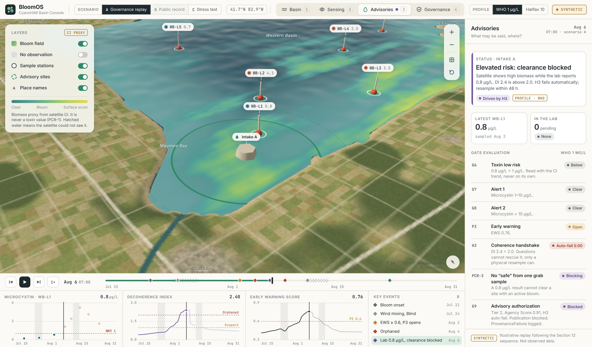
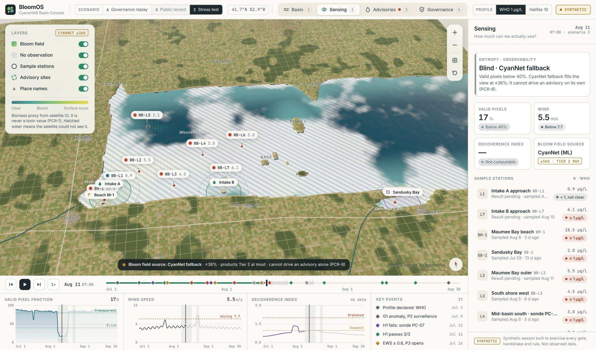
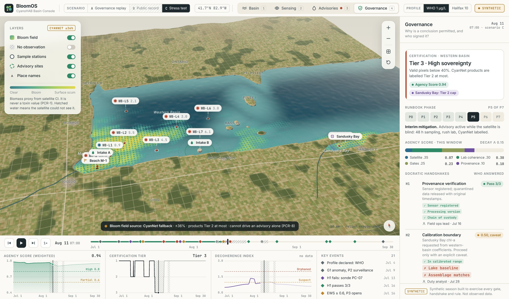
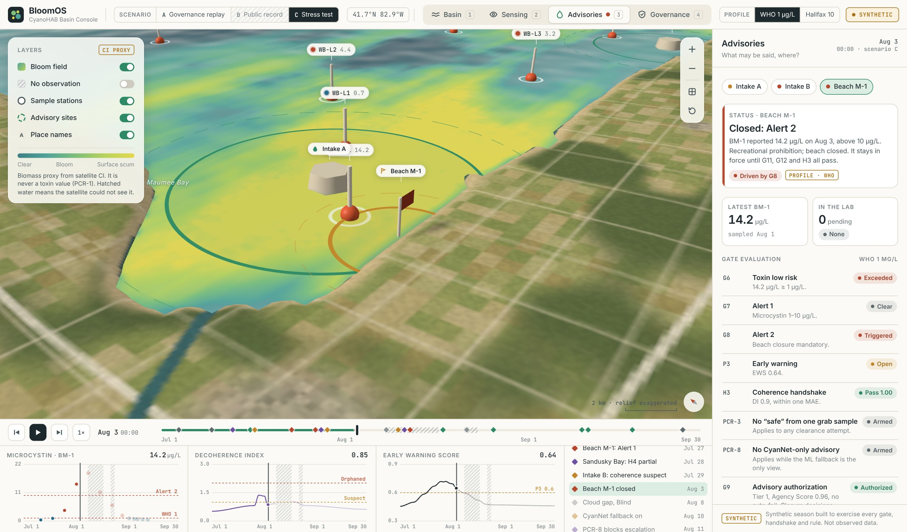

# BloomOS Basin Console: screenshots

An interface demonstrator for the BloomOS specification. **Every value shown is synthetic.**
Scenario A is an illustrative replay following the Section 12 sequence; scenario C is a stress-test
season built to exercise every gate, handshake and rule. Neither is observed data, and neither is
affiliated with or endorsed by NOAA.

### Basin: the bloom and the five process modules
Scenario A, day of the 0.8 µg/L lab result. Satellite and lab disagree, so the bloom state is *Decohering*.

### Advisories: a low result is not clearance
Scenario A. The 0.8 µg/L sample is below 1 µg/L, but the H3 handshake fails automatically and PCR-3
blocks a "safe" call from a single grab sample.

### Sensing: what the satellite cannot see
Scenario C, cloud gap. Unobserved water is hatched rather than drawn as low. The CyanNet fallback is
drawn stippled and cannot drive an advisory on its own (PCR-8).

### Governance: why a conclusion is permitted, and who signed it
Scenario C. Certification tier, Agency Score, runbook phase, handshakes with their answers and
signatories, validators V0–V7 and the eight Prohibited Content Rules.

### Advisories: a beach closure that needs Tier 1
Scenario C. A 14.2 µg/L sample triggers G8; the closure is authorized only because certification is Tier 1.

