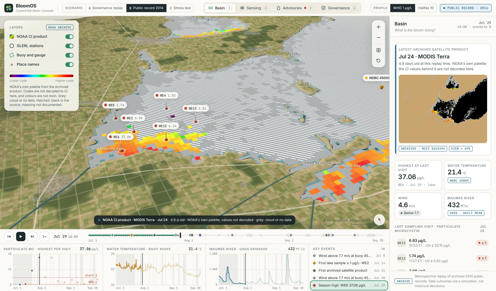
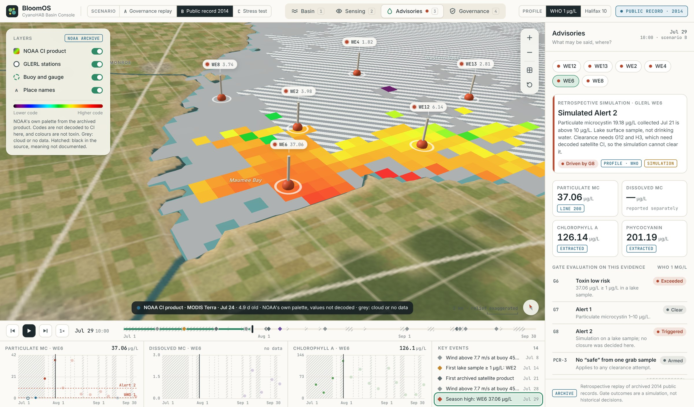
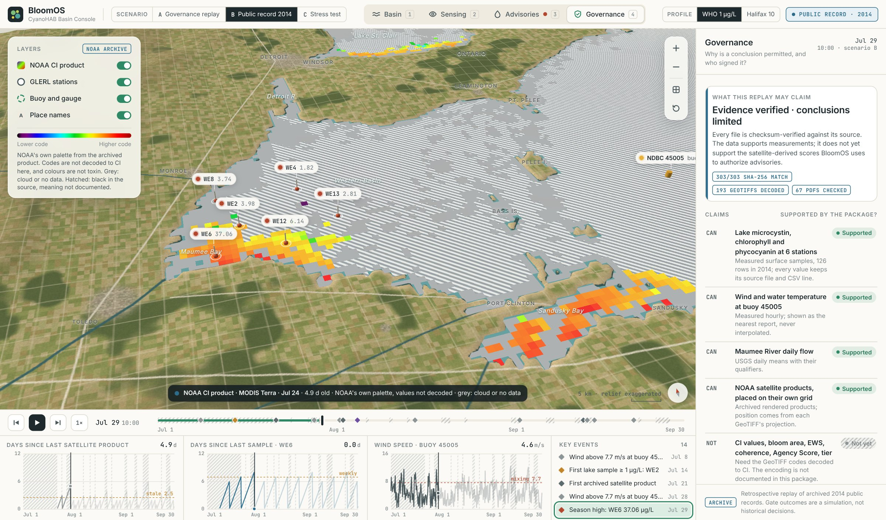

# BloomOS Basin Console: screenshots

An interface demonstrator for the BloomOS specification, drawn on the real western Lake Erie
coastline (derived from NOAA's 2014 HAB satellite products; relief exaggerated). Three scenarios:

- **A · Governance replay** and **C · Stress test** are **synthetic**. A follows the Section 12 sequence;
  C is a season built to exercise every gate, handshake and rule. Neither is observed data.
- **B · Public record 2014** replays **archived public records** from [`data/public-record`](../../data/public-record/README.md):
  GLERL/CIGLR lake samples, NDBC buoy 45005, USGS Maumee River flow and NOAA satellite products. Its gate
  outcomes are a retrospective simulation, not historical decisions.

Nothing here is affiliated with or endorsed by NOAA.

### A · Basin: the bloom and the five process modules
Day of the 0.8 µg/L lab result. Satellite and lab disagree, so the bloom state is *Decohering*.

### A · Advisories: a low result is not clearance
The 0.8 µg/L sample is below 1 µg/L, but H3 fails automatically and PCR-3 blocks a "safe" call from a
single grab sample.

### B · Basin: July 29, 2014, from the archive
At this replay time the newest archived NOAA product is from July 24, shown as 4.9 days old, on its own
1.1 km grid in its own palette (codes not decoded to CI). Pins show particulate microcystin in GLERL lake
surface samples; WE6 recorded 37.06 µg/L in Maumee Bay. Areas black in the source are hatched, not read as values.

### B · Advisories: what the gates can and cannot say
BloomOS gates replayed on GLERL WE6's samples. The simulated alert can never clear, because G12 and H3 need
satellite CI that the package does not decode. Every value carries its source CSV line.

### B · Governance: claims the evidence supports
303 of 303 files checksum-verified. Measurements are supported; satellite-derived scores, drinking-water
concentrations, result-availability times and official actions are not, and the console says so.

### C · Sensing: what the satellite cannot see
Cloud gap. Unobserved water is hatched, not drawn as low. The CyanNet fallback is stippled and cannot drive
an advisory on its own (PCR-8).

### C · Governance: why a conclusion is permitted, and who signed it
Certification tier, Agency Score, runbook phase, handshakes with their answers and signatories,
validators V0–V7 and the eight Prohibited Content Rules.

### C · Advisories: a beach closure that needs Tier 1
A 14.2 µg/L sample triggers G8; the closure is authorized only because certification is Tier 1.

