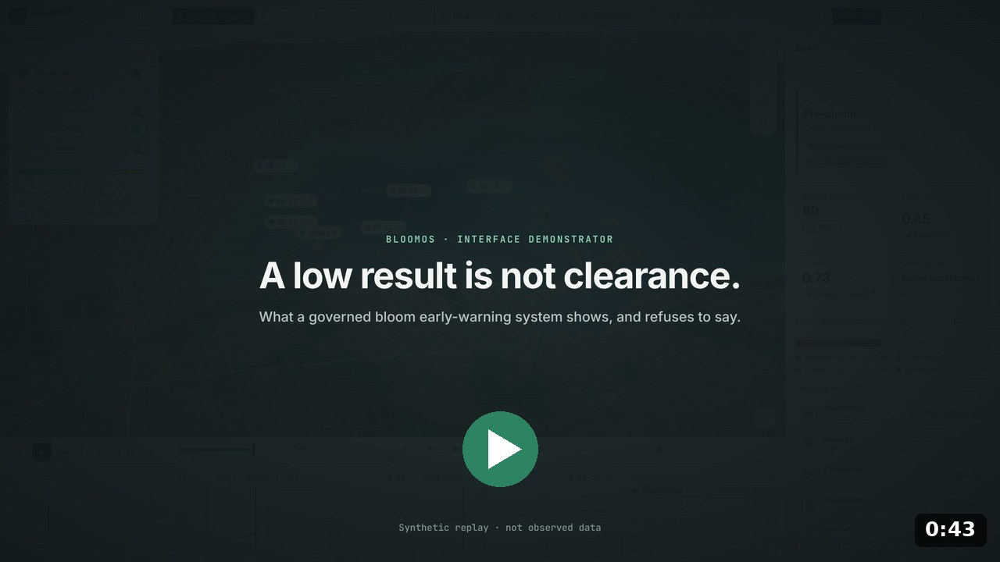
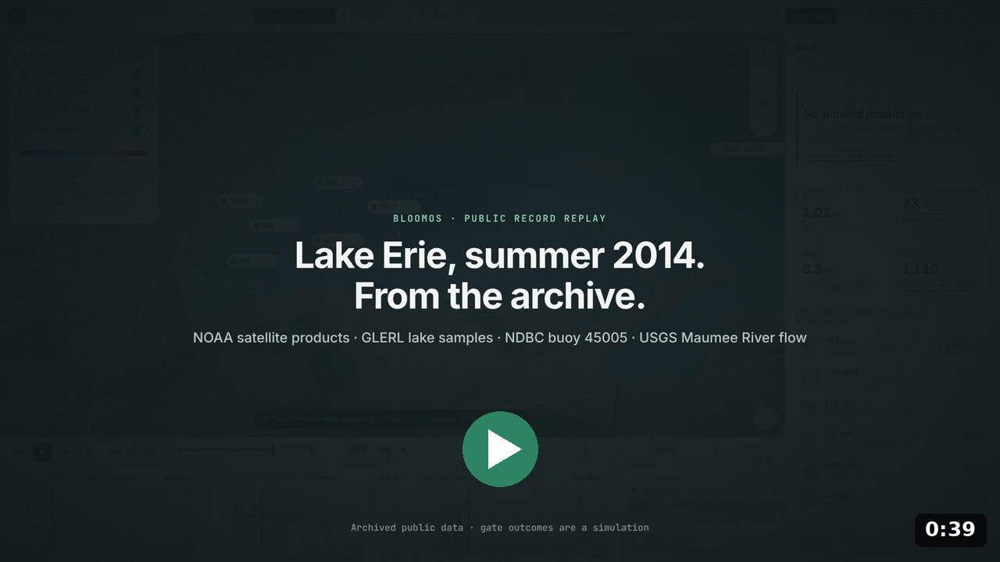
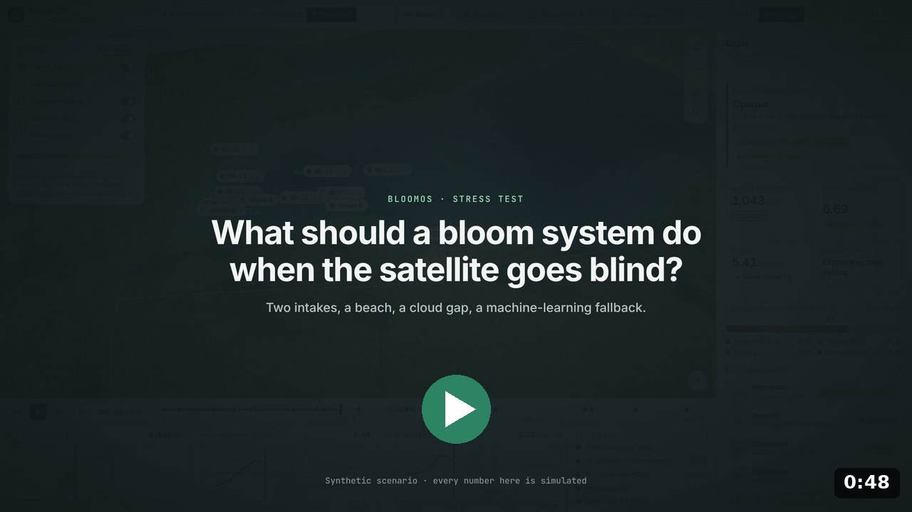

# BloomOS in three short videos

Recorded from the BloomOS Basin Console, an interface demonstrator for the
[BloomOS / CyanoHAB specification](../../README.md), drawn on the real western Lake Erie coastline.
1080p MP4, captioned (they play well muted). Click a poster to open the video.

### 1 · A low result is not clearance (0:43) · *synthetic scenario*
A 0.8 µg/L lab result sits under the 1 µg/L guideline while the satellite shows an accelerating bloom.
BloomOS records the disagreement, blocks the "safe" call, and shows who signed each step.

### 2 · Lake Erie, summer 2014. From the archive. (0:39) · *public record*
The 2014 season replayed from archived public data: NOAA satellite products on their native grid, GLERL/CIGLR
lake samples, NDBC buoy 45005 and USGS Maumee River flow. On July 29, station WE6 in Maumee Bay recorded
37.06 µg/L particulate microcystin in a lake surface sample. The governance view states what this evidence
supports and what it cannot. Gate outcomes are a simulation, not historical decisions. See
[Section 12](../../README.md#section-12-counterfactual-pre-mortem--toledo-2014) and the
[data package](../../data/public-record/README.md).

### 3 · What should a bloom system do when the satellite goes blind? (0:48) · *synthetic scenario*
A stress test of every gate: a beach closure that needs Tier 1, a cloud gap, a machine-learning fallback that
may not drive an advisory on its own, a rush lab sample that decides, and a reopening that takes five low
samples, satellite confirmation and coherence.

---

Data in video 2: NOAA NCEI, GLERL/CIGLR, NDBC and USGS. The interface is not affiliated with or endorsed by any of them.
